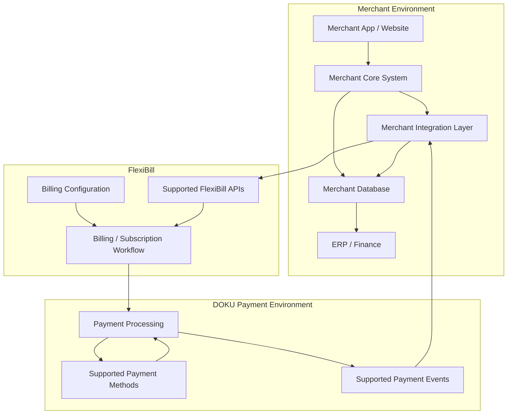
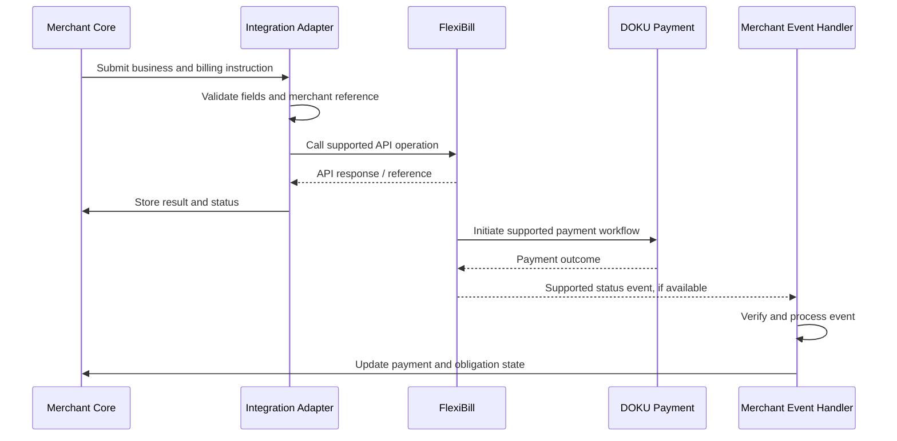

# FlexiBill API & H2H Integration

> A practical guide to designing merchant-to-FlexiBill integrations through supported APIs and Host-to-Host (H2H) workflows.

**Audience:** Engineering, Solution Engineering, Integration, Implementation, Product, and Technical Operations  
**Scope:** Indonesia and Malaysia, subject to country-specific validation  
**Document status:** Internal implementation reference — official DOKU API specifications remain the source of truth for endpoint paths, schemas, authentication, and response codes.

---

## 1. Executive Overview

API and H2H integration allow merchants to connect their own business platforms with FlexiBill and the DOKU payment environment.

This model is relevant when a merchant needs to connect billing and payment workflows to existing systems such as:

- CRM and customer platforms.
- ERP and finance systems.
- Insurance policy administration systems.
- Education and student information systems.
- SaaS and digital subscription platforms.
- Travel and booking platforms.
- Corporate account and billing systems.
- Merchant-owned applications and portals.

The key design principle is:

**Integrate the business obligation, billing workflow, payment transaction, and resulting status — not just the payment API call.**

A successful integration must define the ownership of customer data, billing configuration, billing generation, payment authorization, payment initiation, status synchronization, and reconciliation.

## 2. API Integration Context

This diagram is conceptual. It does not represent confirmed internal service topology or guarantee that every operation shown is exposed through a public API.

## 3. API and H2H Integration Principles

| Principle | Implementation expectation |
|---|---|
| Contract-first integration | Obtain the current API specification before coding |
| Clear system ownership | Define which platform owns each business record and state |
| Stable identifiers | Maintain merchant, customer, billing, and payment references |
| Idempotency | Prevent duplicate processing where supported |
| Secure authentication | Follow the documented authentication and credential requirements |
| Asynchronous processing | Design for delayed status updates where applicable |
| Error classification | Separate technical failures from business and payment failures |
| Reconciliation | Maintain traceability from billing obligation to payment and settlement |
| Environment separation | Keep development, testing, and production credentials and data separate |
| Country validation | Confirm the exact supported flow for Indonesia or Malaysia |

## 4. Integration Lifecycle

A merchant integration should progress through the following stages.

### Stage 1 — Merchant and technical onboarding

Confirm:
- Merchant legal entity and account setup.
- Country and operating scope.
- Integration owner and technical contacts.
- Required product configuration.
- Enabled payment methods.
- Development and production environments.
- Access to the relevant official technical documentation.

**Output:** Approved integration scope and technical prerequisites.

### Stage 2 — Business and data mapping

Define the relationship between merchant records and FlexiBill references.

| Merchant concept | Integration mapping |
|---|---|
| Customer | Customer or member reference |
| Contract / policy / booking | Merchant business reference |
| Subscription | Subscription or membership reference, where supported |
| Invoice / billing obligation | Billing or invoice reference |
| Payment attempt | Payment transaction reference |
| Payment authorization | Applicable authorization or payment-method reference |
| Settlement | DOKU settlement and reconciliation reference |

Do not assume these references are interchangeable. Maintain a mapping table in the merchant integration layer.

### Stage 3 — Configuration

Configure the relevant FlexiBill building blocks through supported interfaces or APIs.

Potential configuration objects include:
- Collection.
- Plan.
- Pricing.
- Pricing Table.
- Member Center.
- Subscription.
- Billing schedule.
- Payment settings.

**Important:** Do not assume that every dashboard function has a corresponding API operation. Confirm the exact API coverage before defining automated provisioning.

### Stage 4 — Customer and billing setup

Depending on the selected model:
- Create or identify the customer.
- Associate the customer with the relevant billing relationship.
- Complete any required registration or authorization process.
- Establish the billing configuration.
- Create or register the billing obligation through a supported workflow.

The customer-facing registration process and backend API readiness must be assessed separately.

### Stage 5 — Billing and payment execution

The merchant or FlexiBill executes the agreed billing workflow.

A payment flow may involve:
1. Billing becomes due.
2. The relevant system initiates the supported payment operation.
3. DOKU processes the payment.
4. The payment result is returned synchronously or asynchronously, depending on the integration.
5. The merchant updates its business record.
6. Reconciliation confirms the financial outcome.

### Stage 6 — Monitoring and reconciliation

Monitor:
- API request and response outcomes.
- Billing generation and status.
- Payment attempts and results.
- Delayed or missing status updates.
- Duplicate requests and events.
- Unmatched billing and payment references.
- Settlement and reconciliation exceptions.

## 5. API Capability Mapping

The following table is a capability discovery and validation guide. It is not an assertion that every operation is currently available through a public API.

| Capability area | What the integration may need | Validation requirement |
|---|---|---|
| Customer / Member | Create, inquire, update, or identify member | Confirm exact operations and field coverage |
| Collection | Create and configure a collection | Confirm API availability and permissions |
| Plan | Create and configure a plan | Confirm supported pricing and schedule fields |
| Pricing Table | Create and manage a pricing table | Validate known API coverage gaps |
| Subscription | Create or inquire about subscription | Confirm lifecycle operations and supported states |
| eBilling | Create a billing obligation | Confirm supported billing creation workflow |
| Membership Inquiry | Retrieve membership information | Confirm current operation and response contract |
| Payment authorization | Register or maintain payment credentials or mandate | Confirm payment-method-specific authorization flow |
| Recurring payment | Trigger or execute a recurring payment workflow | Confirm applicable WT / AB flow and eligibility |
| Billing status | Retrieve billing or invoice status | Confirm supported inquiry operations |
| Payment status | Retrieve payment outcome | Confirm transaction inquiry capability |
| Webhook | Receive asynchronous updates | Confirm event types, security, and retry behavior |
| Reporting / Export | Retrieve billing and payment data | Confirm format, availability, and access method |

### Existing operation names and terminology

The internal FlexiBill capability discussions have referenced terms such as:

- Create Subscription.
- Create eBilling.
- Inquiry Membership.
- WT — token and deduction flow.
- AB — deduction-only flow.

Treat these as terminology to verify against the current official technical specification. Do not infer endpoint names, request formats, token behavior, or authorization rules from the abbreviations alone.

## 6. Reference API Interaction Pattern

The following sequence describes a generic integration pattern, not a literal DOKU endpoint sequence.

### Key implementation rules

- Store the request reference and returned DOKU reference.
- Distinguish request acceptance from final payment success.
- Do not assume a successful API response means a successful payment.
- Do not assume a timeout means the request was not processed.
- Use transaction inquiry or the documented recovery mechanism when an outcome is uncertain.
- Process repeated events safely.

## 7. Merchant Integration Adapter

For complex merchants, use a dedicated integration layer rather than tightly coupling every business application to the payment interface.

### Recommended responsibilities

| Function | Purpose |
|---|---|
| Request validation | Validate required fields and business references |
| Data mapping | Convert merchant objects into the documented API contract |
| Authentication | Apply supported credential and authorization mechanisms |
| Idempotency control | Prevent unintended duplicate processing |
| Request tracking | Store correlation and transaction references |
| Response normalization | Translate technical outcomes into merchant application states |
| Event processing | Receive and route supported asynchronous updates |
| Retry management | Apply approved retry and recovery rules |
| Logging | Maintain traceable operational records without exposing sensitive data |
| Reconciliation | Match merchant obligations to payment and settlement records |

### Architecture recommendation

Keep business logic separate from transport logic.

For example:
- The merchant core determines whether an insurance premium is due.
- The integration adapter converts that obligation into a supported billing instruction.
- FlexiBill handles the configured billing workflow.
- DOKU processes the supported payment transaction.
- The merchant core decides whether the policy or service status should change.

## 8. Data Mapping and Identifier Strategy

A robust integration requires a consistent identifier model.

| Identifier | Description | Recommended handling |
|---|---|---|
| Merchant ID | Identifies the DOKU merchant account | Use the assigned identifier |
| Merchant Customer ID | Identifies the customer in the merchant system | Maintain a stable mapping |
| Merchant Business Reference | Identifies policy, booking, contract, or account | Preserve as the business reference |
| FlexiBill Customer / Member Reference | Identifies the applicable FlexiBill record | Store the returned or assigned reference |
| Billing ID | Identifies the billing obligation | Preserve across billing and payment records |
| Payment Transaction ID | Identifies the payment transaction | Use for payment inquiry and reconciliation |
| Correlation ID | Links related integration requests and events | Generate and persist consistently |

**Recommended rule:** One business obligation may have multiple payment attempts. Do not overwrite the obligation identifier with a payment transaction identifier.

## 9. Idempotency and Duplicate Prevention

Duplicate processing can create:
- Duplicate billing obligations.
- Duplicate payment attempts.
- Incorrect customer balances.
- Conflicting merchant and DOKU statuses.
- Reconciliation exceptions.

### Recommended controls

1. Generate a stable merchant-side reference for each business action.
2. Check whether the action has already been processed.
3. Use a documented idempotency mechanism if the API supports it.
4. Store the request and response outcome.
5. For uncertain outcomes, inquire or reconcile before repeating the action.
6. Handle repeated events without repeating the business action.

**Important:** Do not invent an idempotency header, key format, retention period, or guarantee. Confirm the actual behavior in the official API contract.

## 10. Error and Response Handling

Classify errors before deciding what to do.

| Error category | Example | Recommended response |
|---|---|---|
| Validation | Missing or invalid field | Correct the request |
| Authentication | Invalid or expired credential | Verify configuration and credential handling |
| Authorization | Merchant or operation not permitted | Check account entitlement and permissions |
| Business rule | Billing or subscription state does not permit action | Resolve the underlying business state |
| Network / timeout | No reliable response received | Verify outcome before retrying |
| Payment failure | Payment method declines or transaction fails | Apply approved recovery workflow |
| Event delivery | Merchant endpoint unavailable | Recover using documented delivery or inquiry mechanisms |
| Reconciliation mismatch | Billing and payment records disagree | Investigate using transaction references and authoritative status |

The actual HTTP status, error code, and retryability must be determined from the official API specification.

## 11. Security and Credential Management

Follow the current DOKU security specification.

At minimum:
- Use approved authentication methods.
- Keep secrets outside source code and public repositories.
- Separate credentials by environment.
- Restrict access using least privilege.
- Rotate credentials according to the applicable security policy.
- Protect sensitive customer and payment data.
- Verify event authenticity where required.
- Avoid logging secrets, access tokens, and prohibited payment data.
- Maintain audit trails for privileged operations.

Never place production credentials in GitHub documentation or test examples.

## 12. API Testing Strategy

| Test group | Example scenarios | Expected validation |
|---|---|---|
| Connectivity | Valid request, unavailable service | Connection and timeout handling |
| Authentication | Valid and invalid credentials | Correct access behavior |
| Validation | Missing, malformed, or unsupported fields | Clear rejection and logging |
| Customer | Valid and duplicate customer reference | Correct mapping behavior |
| Billing | Valid, invalid, and repeated billing request | Correct billing outcome |
| Subscription | Valid creation and unsupported lifecycle action | Correct state handling |
| Payment | Success, failure, pending, and uncertain outcome | Correct payment-state synchronization |
| Idempotency | Repeat the same business instruction | No unintended duplicate action |
| Webhook | Valid, invalid, duplicate, delayed event | Safe event processing |
| Recovery | Timeout followed by inquiry | No duplicate payment |
| Reconciliation | Matching and mismatching records | Exception detection |
| Security | Unauthorized access and sensitive-data exposure checks | Security controls work as designed |

## 13. Go-Live Readiness Checklist

### Business and product
- [ ] Merchant business and billing model confirmed.
- [ ] Required FlexiBill capabilities validated.
- [ ] Product configuration completed.
- [ ] Country-specific scope confirmed.

### Technical
- [ ] Current API specification reviewed.
- [ ] Authentication and credentials configured securely.
- [ ] Data mapping approved.
- [ ] Integration adapter tested.
- [ ] Duplicate prevention implemented.
- [ ] Error and timeout handling tested.
- [ ] Event integration tested where applicable.
- [ ] Logging and monitoring configured.

### Operational
- [ ] Payment and billing reconciliation defined.
- [ ] Exception ownership assigned.
- [ ] Support escalation path agreed.
- [ ] Recovery procedures documented.
- [ ] Production access approved.
- [ ] Rollback or suspension plan agreed.

## 14. Common Integration Anti-Patterns

| Anti-pattern | Why it is risky | Better approach |
|---|---|---|
| Treating API acceptance as payment success | Payment may remain pending or fail | Verify final payment status |
| Using payment ID as billing ID | Breaks obligation-to-attempt traceability | Maintain separate identifiers |
| Retrying every timeout immediately | May create duplicate actions | Verify outcome before retry |
| Assuming dashboard feature equals API feature | API coverage may differ | Validate each operation |
| Hardcoding production credentials | Creates security exposure | Use secure secret management |
| Ignoring asynchronous events | Causes stale merchant records | Implement event processing and recovery |
| Treating payment success as service activation | Merchant business rules may not be satisfied | Let the merchant system decide fulfillment |
| Assuming Indonesia and Malaysia are identical | Creates country-specific implementation risk | Validate each country independently |

## 15. Indonesia and Malaysia Considerations

Before implementing, confirm separately for each country:

- Merchant account and product eligibility.
- Supported payment methods.
- Recurring authorization requirements.
- Supported API operations.
- Webhook and inquiry coverage.
- Billing and subscription configuration.
- Settlement and reconciliation process.
- Local operational and regulatory requirements.

Do not represent an API or payment method as available in both countries based on validation in only one.

## 16. Related Documentation

- [Integration Architecture](01-integration-architecture.md)
- [Webhook & Event Management](03-webhook-and-event-management.md)
- [Billing Orchestration](04-billing-orchestration.md)
- [Payment Authorization & Collection](05-payment-authorization-and-collection.md)
- [Error Handling & Recovery](06-error-handling-and-recovery.md)
- [Reconciliation & Reporting](07-reconciliation-and-reporting.md)
- [Security & Data Protection](08-security-and-data-protection.md)
- [Testing & Certification](09-testing-and-certification.md)

---

**FlexiBill API & H2H Integration**

*Build the contract. Protect the transaction. Synchronize the outcome. Reconcile the obligation.*
