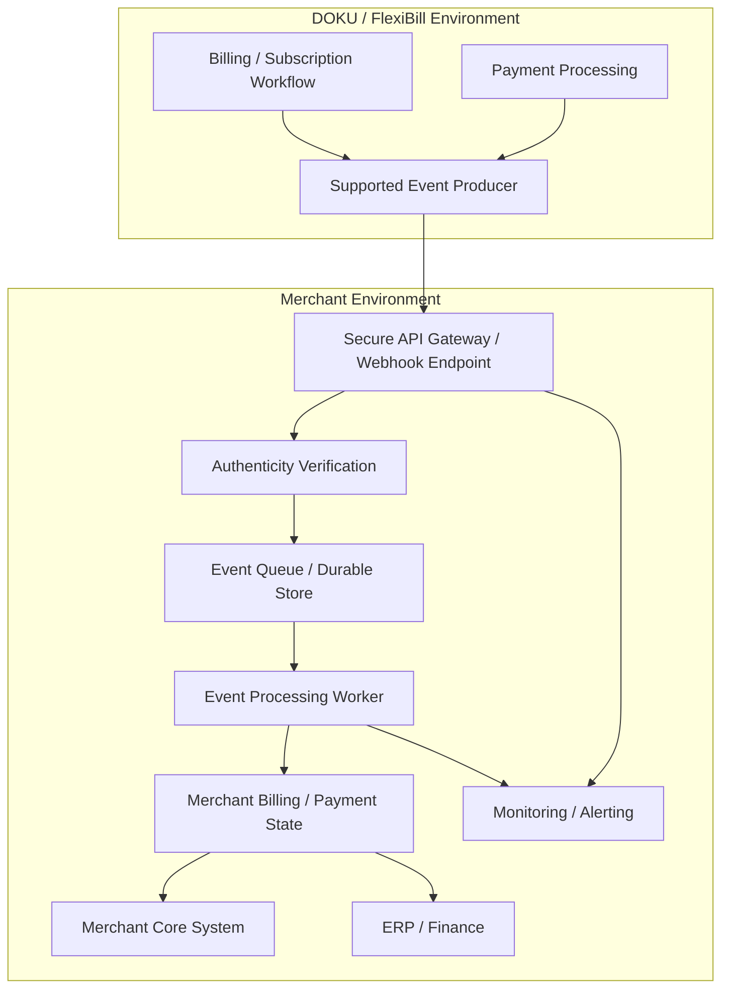
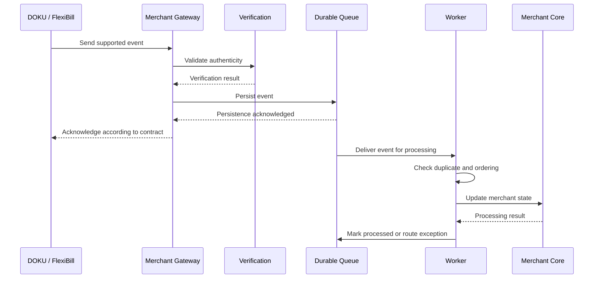
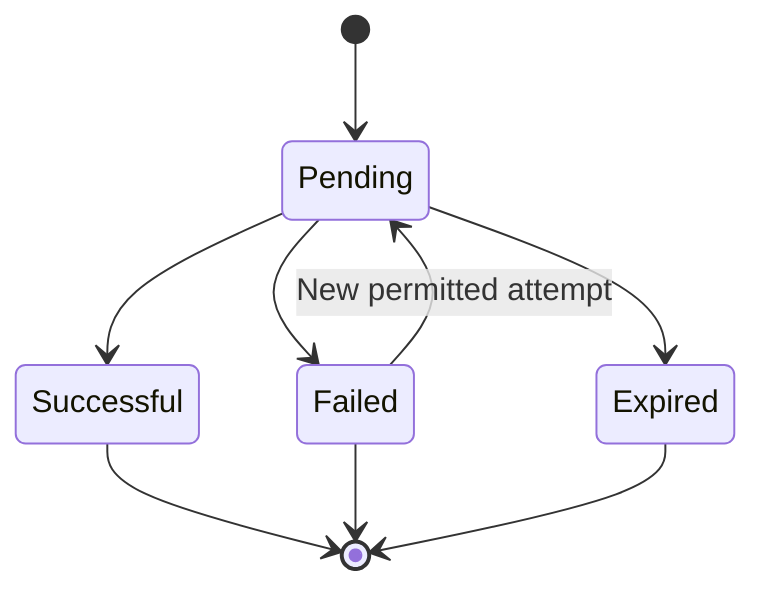

# FlexiBill Webhook & Event Management

> Technical guide to receiving, verifying, processing, and reconciling asynchronous billing and payment events.

**Audience:** Engineering, Solution Engineering, Integration, Implementation, Product, and Technical Operations  
**Scope:** Indonesia and Malaysia, subject to country-specific validation  
**Document status:** Internal implementation reference — verify actual event names, payloads, signature mechanisms, delivery guarantees, and retry policies against current DOKU technical documentation.

---

## 1. Executive Overview

A merchant integration cannot rely exclusively on the immediate response from an API request.

Payment and billing workflows may involve asynchronous processing. A transaction may initially be pending, while the final outcome becomes available later through a supported notification, webhook, inquiry operation, or another documented mechanism.

Webhooks and events help synchronize the merchant's systems with relevant billing and payment outcomes.

A reliable event architecture must answer five questions:

1. How does the merchant receive an event?
2. How does the merchant verify that the event is authentic?
3. How does the merchant determine whether the event is new, repeated, or out of order?
4. How does the merchant update its billing and business records?
5. How does the merchant recover when an event is delayed, duplicated, or not received?

**Core principle:** Treat a webhook as a signal to process or verify a state change, not as permission to blindly execute a business action.

## 2. Webhook Architecture

This is a conceptual merchant-side reference architecture. It does not assert a particular DOKU deployment topology or guarantee that every billing and payment event is available through a webhook.

## 3. Webhook vs Synchronous API Response

| Dimension | Synchronous API response | Webhook / asynchronous event |
|---|---|---|
| Trigger | Merchant sends a request | Provider sends a notification |
| Direction | Usually merchant to provider | Usually provider to merchant |
| Timing | During request-response interaction | May occur later |
| Purpose | Acknowledge or respond to the API operation | Communicate an event or status update |
| Availability | Depends on the API operation | Depends on supported event coverage |
| Main risk | Timeout or uncertain response | Delayed, repeated, or missed event |
| Recovery | Inquiry or documented retry | Event recovery and status inquiry |

An API response indicating that a request was accepted must not automatically be interpreted as final payment success.

## 4. Event Categories to Consider

The following are conceptual event categories for integration design. They are not confirmed literal DOKU webhook event names.

| Event category | Business meaning | Merchant action |
|---|---|---|
| Billing created | Billing obligation has been generated | Store and associate billing reference |
| Billing updated | Billing attributes or state have changed | Update merchant billing record |
| Billing expired | Billing is no longer payable under the applicable rules | Apply merchant overdue or expiration process |
| Subscription created | Subscription setup has completed | Link subscription to merchant contract |
| Subscription status changed | Subscription lifecycle state has changed | Synchronize the merchant's subscription record |
| Payment initiated | Payment process has started | Track payment attempt |
| Payment pending | Final payment outcome is not yet known | Keep transaction in pending state |
| Payment successful | Payment has reached a successful outcome | Verify and apply merchant business rules |
| Payment failed | Payment attempt has failed | Apply approved recovery process |
| Refund or reversal update | Financial outcome has changed | Update payment and finance records |

**Validation required:** Confirm the actual event catalogue, event naming, payload fields, and supported subscription/billing event coverage from official DOKU documentation.

## 5. Recommended Event Processing Lifecycle

The acknowledgement response, timeout behavior, and retry semantics must follow the provider's documented contract. Do not assume that an HTTP success response always has the same operational meaning across integrations.

### Recommended sequence

1. Receive the incoming event.
2. Validate the request using the documented authenticity mechanism.
3. Validate required fields and structure.
4. Persist the event durably.
5. Acknowledge receipt within the documented timeout.
6. Process asynchronously.
7. Check for duplicate delivery.
8. Verify the event against the current transaction or billing state when necessary.
9. Update the merchant's records.
10. Record processing outcome and operational trace.
11. Route unresolved events to an exception process.

## 6. Webhook Endpoint Design

The merchant endpoint should be designed for reliability and security.

### Endpoint responsibilities

- Accept only supported event requests.
- Apply the required authentication or signature verification.
- Validate the expected request structure.
- Reject invalid requests according to the agreed contract.
- Persist accepted events before acknowledging them.
- Avoid executing lengthy business workflows inside the request handler.
- Return the documented acknowledgement response.
- Maintain an auditable processing record.

### Recommended endpoint characteristics

| Design area | Recommended practice |
|---|---|
| Availability | Deploy with appropriate availability and recovery controls |
| Security | Use the documented authenticity and transport security mechanisms |
| Processing | Separate request acceptance from business processing |
| Persistence | Store events durably before acknowledging |
| Performance | Keep request handling within the documented timeout |
| Logging | Record event references and processing outcomes |
| Monitoring | Alert on elevated failures, backlog, and processing delays |
| Recovery | Support replay or inquiry-based recovery where available |

## 7. Event Authenticity and Security

Never assume that a request is authentic merely because it reaches a public endpoint.

Follow the exact verification mechanism specified in the official DOKU integration documentation.

Depending on the documented integration, this may involve:
- Signature verification.
- Shared-secret validation.
- Authentication headers.
- Request timestamp validation.
- Replay protection.
- Approved network controls.

Do not invent header names, signature algorithms, canonicalization rules, or secret formats.

### Security checklist

- [ ] Verify the event using the documented mechanism.
- [ ] Reject invalid or tampered requests.
- [ ] Protect credentials and signing secrets.
- [ ] Prevent secrets from appearing in logs.
- [ ] Apply access restrictions and secure transport.
- [ ] Protect customer and payment data.
- [ ] Define replay and duplicate handling.
- [ ] Maintain an audit trail.
- [ ] Establish credential rotation and incident response processes.

## 8. Duplicate Event Handling and Idempotency

A provider may deliver the same event more than once, depending on its delivery and retry model.

A merchant must therefore be prepared to process duplicate events safely.

### Recommended design

Maintain an event-processing record containing:

| Field | Purpose |
|---|---|
| Event ID | Unique event identifier, if provided |
| Transaction ID | Associated payment transaction |
| Billing ID | Associated billing obligation |
| Merchant reference | Business-level identifier |
| Event type | Event category |
| Event timestamp | Provider event time, if provided |
| Received timestamp | Merchant receipt time |
| Processing status | Received, processing, processed, failed |
| Payload fingerprint | Optional integrity and duplicate-detection support |
| Error detail | Processing failure information |

### Processing rule

If an event has already been successfully processed, do not repeat the same business action.

Where a provider does not expose a unique event ID, define a documented deduplication strategy using stable event and transaction attributes. Do not rely on an arbitrary field combination without validating its uniqueness.

### Important distinction

Event deduplication and payment idempotency are different controls:

- Event deduplication prevents repeated handling of the same notification.
- Payment idempotency prevents repeated execution of the same payment instruction where supported.

Both may be necessary.

## 9. Out-of-Order Events and State Management

Events may be received later than expected or in a different order from their originating actions.

For example, a merchant may receive a delayed event after it has already retrieved a newer transaction state through an inquiry operation.

### Recommended controls

1. Store the provider event timestamp when available.
2. Store the merchant receipt timestamp separately.
3. Maintain an explicit state-transition model.
4. Reject invalid or backward state transitions where appropriate.
5. Use an authoritative inquiry operation when the event conflicts with the current record.
6. Keep an exception record for unresolved conflicts.
7. Do not allow an old event to overwrite a verified newer state.

### Conceptual state example

This is an illustrative state model, not a confirmed DOKU transaction state machine. Actual state transitions must follow the official payment contract and merchant business rules.

## 10. Billing State vs Payment State vs Business State

These states must remain separate.

| Domain | Example | What it means |
|---|---|---|
| Billing | Due | A billing obligation is payable |
| Payment | Pending | A payment attempt has no final confirmed outcome |
| Payment | Successful | The payment transaction has succeeded |
| Business | Active | The merchant considers the service or contract active |
| Business | Suspended | The merchant has restricted the service |
| Business | Reinstated | The merchant has restored the service under its own rules |

A successful payment does not automatically determine whether a policy, subscription entitlement, booking, or membership should be activated.

The merchant's business system owns that decision.

## 11. Recovery When Events Are Missing

Webhook delivery alone should not be the only source of truth for long-term payment reconciliation.

Design a recovery process for:
- Events that never arrive.
- Events that arrive after the expected time.
- Merchant endpoint outages.
- Event processing failures.
- Invalid payloads.
- Events that cannot be matched to a merchant record.
- Conflicting event and inquiry results.

### Recovery approach

1. Identify pending or unresolved transactions.
2. Use the supported payment inquiry or reconciliation mechanism.
3. Compare the authoritative transaction outcome with the merchant record.
4. Update the merchant state through a controlled process.
5. Record the recovery action and its source.
6. Escalate unresolved mismatches.

The frequency and timing of recovery checks should be agreed with DOKU Operations and Engineering. Do not assume a universal polling interval.

## 12. Monitoring and Alerting

| Metric | What it identifies |
|---|---|
| Events received | Incoming event volume |
| Authenticity failures | Invalid or suspicious event requests |
| Acknowledgement failures | Merchant endpoint response problems |
| Duplicate event rate | Repeated event deliveries |
| Processing success rate | Events processed successfully |
| Processing latency | Time from receipt to completion |
| Event backlog | Events awaiting processing |
| Unmatched event count | Events without a corresponding merchant record |
| Pending transaction age | Transactions awaiting final resolution |
| State mismatch count | Disagreement between merchant and provider records |
| Recovery success rate | Events or statuses successfully recovered |

Set alert thresholds according to merchant volume, operational risk, and agreed service objectives.

## 13. Testing Strategy

| Test case | Expected behavior |
|---|---|
| Valid event | Authenticity verified and event persisted |
| Invalid signature or authenticity check | Request rejected according to contract |
| Duplicate event | No duplicate business action |
| Delayed event | Correct state maintained |
| Out-of-order event | Older state does not overwrite verified newer state |
| Unknown transaction | Event routed to exception handling |
| Missing required field | Validation error recorded |
| Merchant endpoint outage | Provider and merchant recovery behavior verified |
| Worker failure | Persisted event can be safely reprocessed |
| Database failure | Event is not acknowledged as durably accepted |
| Conflicting event and inquiry | Authoritative status is reconciled |
| High-volume burst | Queue and processing capacity remain within agreed limits |

## 14. Operational Ownership

| Activity | Primary owner |
|---|---|
| Provider event generation and delivery | DOKU / relevant provider, within documented responsibilities |
| Endpoint availability | Merchant Engineering |
| Event verification | Merchant Engineering |
| Event persistence and processing | Merchant Engineering |
| Payment status interpretation | Jointly defined; authoritative payment outcome follows DOKU payment records |
| Business status update | Merchant core system owner |
| Reconciliation | Merchant Finance / Operations with DOKU support as applicable |
| Incident management | Agreed merchant and DOKU operational owners |

Every production implementation should define an escalation contact and an incident handoff procedure.

## 15. Indonesia and Malaysia Validation

Confirm independently for each country and merchant setup:

- Supported webhook event categories.
- Event payload and reference fields.
- Authentication and signature mechanism.
- Delivery and retry guarantees.
- Acknowledgement requirements.
- Payment inquiry coverage.
- Subscription and billing status event coverage.
- Operational support and incident process.
- Local data protection requirements.

Do not assume that a webhook available in Indonesia is automatically available in Malaysia.

## 16. Go-Live Checklist

- [ ] Official event specification reviewed.
- [ ] Supported event types confirmed.
- [ ] Endpoint security implemented.
- [ ] Authenticity verification tested.
- [ ] Durable event persistence implemented.
- [ ] Acknowledgement behavior validated.
- [ ] Duplicate handling implemented.
- [ ] Out-of-order event handling tested.
- [ ] State-transition rules approved.
- [ ] Inquiry-based recovery defined.
- [ ] Monitoring and alerting configured.
- [ ] Reconciliation process agreed.
- [ ] Incident ownership and escalation documented.
- [ ] Country-specific behavior validated.

## 17. Related Playbooks

- [Integration Architecture](01-integration-architecture.md)
- [API & H2H Integration](02-api-and-h2h-integration.md)
- [Billing Orchestration](04-billing-orchestration.md)
- [Payment Authorization & Collection](05-payment-authorization-and-collection.md)
- [Error Handling & Recovery](06-error-handling-and-recovery.md)
- [Reconciliation & Reporting](07-reconciliation-and-reporting.md)
- [Security & Data Protection](08-security-and-data-protection.md)
- [Testing & Certification](09-testing-and-certification.md)

---

**FlexiBill Webhook & Event Management**

*Receive securely. Persist reliably. Process idempotently. Reconcile authoritatively.*
