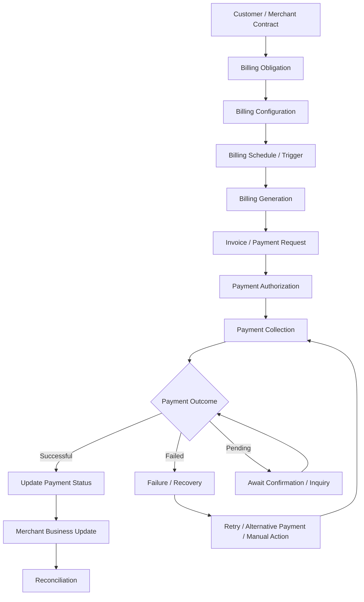

# FlexiBill Billing Orchestration

> How merchant business obligations become configured billing workflows, payable invoices, payment attempts, and reconciled outcomes.

**Audience:** Product, Engineering, Solution Engineering, Implementation, Operations, and Business Development  
**Scope:** Indonesia and Malaysia, subject to country-specific validation  
**Document status:** Internal implementation reference — validate actual product behavior and technical contracts against current DOKU documentation.

---

## 1. Executive Overview

Billing orchestration connects a merchant's commercial relationship with the process of collecting money.

It coordinates the journey from:

1. Customer and commercial setup.
2. Billing rule definition.
3. Billing obligation creation.
4. Invoice or payment request generation.
5. Payment collection.
6. Payment outcome synchronization.
7. Failure and overdue management.
8. Reconciliation and reporting.

FlexiBill provides supported billing and subscription workflows that can be configured for different merchant models.

However, billing orchestration is not the same as owning every merchant business rule. A merchant may still own customer eligibility, pricing calculations, usage calculations, contract changes, service fulfillment, and accounting.

**Core principle:** Every billing obligation must have a clear business owner, amount owner, schedule owner, payment owner, and reconciliation path.

## 2. Billing Orchestration Architecture

This is a conceptual business flow, not a confirmed internal service topology or universal FlexiBill state machine.

## 3. The Five Layers of Billing Orchestration

| Layer | Main responsibility | Typical owner |
|---|---|---|
| Commercial layer | Product, price, contract, customer eligibility | Merchant |
| Billing layer | Billing configuration, billing obligation, schedule, invoice | FlexiBill or merchant, depending on model |
| Payment layer | Authorization, payment initiation, payment processing | DOKU and relevant payment partners |
| Business outcome layer | Service activation, suspension, renewal, fulfillment | Merchant |
| Financial control layer | Reconciliation, settlement, accounting | Merchant Finance with DOKU reporting and support |

The architecture should make these layers explicit.

## 4. Billing Models

Not every recurring or scheduled payment represents the same commercial model.

| Model | Description | Example |
|---|---|---|
| Fixed recurring | Same amount on a recurring schedule | Monthly gym membership |
| Variable recurring | Amount changes according to merchant-defined rules | Insurance premium adjustment |
| Usage-based | Amount depends on measured usage | SaaS consumption |
| Installment | A defined obligation is divided into scheduled payments | Travel booking installment |
| Calendar-date account billing | Billing is organized around an account-level billing date | Corporate account billing |
| Event-driven | Billing is triggered by a business event | Registration or booking confirmation |
| One-time billing | Single payment obligation | Enrollment fee |

A recurring payment mechanism does not automatically mean the underlying business arrangement is a subscription.

For example, a travel booking paid in three installments is not necessarily a recurring service subscription.

## 5. End-to-End Billing Lifecycle

### Stage 1 — Customer and commercial setup

The merchant establishes:
- Customer identity.
- Product or service.
- Contract or commercial agreement.
- Pricing rules.
- Billing frequency.
- Payment responsibility.
- Required authorization.
- Service eligibility.

**System ownership:** Usually the merchant CRM, ERP, policy, booking, membership, or core business system.

### Stage 2 — Billing configuration

The relevant FlexiBill configuration may include:

- Collection.
- Plan.
- Pricing model.
- Pricing Table, where applicable.
- Member Center, where applicable.
- Billing schedule.
- Payment configuration.

The exact configuration depends on the selected product and integration model.

### Stage 3 — Billing obligation creation

A billing obligation represents the amount the customer is expected to pay.

The implementation must define:
- Unique billing reference.
- Customer or payer reference.
- Amount and currency.
- Description.
- Due date or collection date.
- Related contract or subscription.
- Billing status.
- Applicable payment options.

The merchant must define which system calculates and owns the amount.

### Stage 4 — Billing generation

Billing may be generated through a supported FlexiBill workflow or a merchant-owned process.

Potential patterns:
- Scheduled recurring billing.
- Manual billing creation.
- Batch or file-based billing.
- API-based billing creation.
- Account Billing.
- Merchant-controlled scheduling.

Do not assume every pattern is available for every merchant, country, or configuration.

### Stage 5 — Customer notification and payment access

The customer may receive an applicable billing notification, payment link, or access through a supported Billing Portal or other merchant interface.

Confirm:
- Notification channel.
- Payment link behavior.
- Portal availability.
- Customer authentication.
- Bill visibility.
- Payment method availability.
- Expiry and overdue behavior.

Do not assume a customer-facing interface is automatically enabled because the backend API exists.

### Stage 6 — Payment authorization and collection

The payment workflow depends on the payment method and authorization model.

Possible patterns include:
- Customer-initiated payment.
- Authorized recurring auto-debit.
- Token-based payment workflow.
- Other supported payment mechanisms.

The exact authorization, credential, and recurring collection requirements must be confirmed against the relevant payment method documentation.

### Stage 7 — Payment outcome and business update

The merchant receives or retrieves the relevant payment outcome.

The merchant must:
- Update its payment record.
- Update the associated billing obligation.
- Apply its own business rules.
- Activate, continue, suspend, or fulfill the service as appropriate.

A payment result alone does not determine the merchant's contract or service status.

### Stage 8 — Reconciliation and reporting

Match:
- Business obligation.
- Billing record.
- Payment attempt.
- Successful payment transaction.
- Settlement record.
- Merchant accounting entry.

Maintain a traceable relationship between these records.

## 6. Billing Configuration Building Blocks

### A. Collection

A Collection is a product configuration building block used in the relevant FlexiBill workflows.

Implementation considerations:
- Product or service grouping.
- Customer and member association.
- Applicable expiry or grace rules.
- Collection lifecycle and eligibility.
- Relationship to Plans.

Confirm the exact supported fields and behaviors for the intended merchant configuration.

### B. Plan

A Plan defines the applicable billing and pricing arrangement within the supported configuration model.

Potential pricing models include:

| Pricing model | Concept | Example |
|---|---|---|
| Flat Fee | Fixed amount | Rp250,000 monthly |
| Per Unit | Amount multiplied by units | Rp50,000 per user |
| Tiered | Different unit rates across usage bands | First 100 units at one rate, next band at another |
| Volume | Rate determined by total usage band | A single applicable rate based on total volume |
| Stairstep | Fixed charge for a defined range | Fixed monthly charge for a usage bracket |
| Open Amount | Customer or merchant enters an amount within permitted rules | Donation or flexible payment |

These are conceptual pricing descriptions. Confirm the actual calculation behavior, field support, and API availability before implementation.

### C. Pricing Table

A Pricing Table can provide a customer-facing way to discover and select an applicable pricing offer or plan, where enabled.

Validate:
- One-time versus recurring setup.
- Customer registration flow.
- Payment method availability.
- Coupon and tax behavior.
- Checkout experience.
- API coverage.
- Placement on websites, apps, or other channels.

Do not assume every seller dashboard or WhatsApp interface is supported.

### D. Member Center

Member Center supports relevant member-related workflows within its confirmed scope.

Validate separately:
- Backend member API readiness.
- Customer-facing registration experience.
- Member inquiry.
- Membership status.
- Merchant-specific integration.
- Customer verification.

API readiness does not automatically mean that a complete customer-facing registration interface is available.

### E. Billing Portal

Billing Portal can provide applicable customer-facing billing interactions.

Potential requirements include:
- Viewing billing information.
- Accessing payment instructions.
- Reviewing payment status.
- Managing applicable billing interactions.

Confirm which actions are enabled in the intended merchant setup. Do not promise plan changes, payment-method changes, cancellation, pause, resume, or other lifecycle controls without validation.

### F. Account Billing

Account Billing supports an account-based billing pattern using configured billing dates within its applicable product scope.

It may be relevant when the merchant organizes obligations around customer accounts rather than only individual subscription start dates.

Validate:
- Account setup.
- Billing date behavior.
- Obligation generation.
- Payment collection.
- Reporting and reconciliation.
- Country and merchant eligibility.

Do not assume account hierarchy, consolidated invoicing, or cross-obligation allocation unless confirmed.

## 7. Billing Schedule and Trigger Design

Every billing implementation needs a schedule model.

| Schedule attribute | Definition |
|---|---|
| Start date | When the billing relationship begins |
| Billing frequency | Daily, weekly, monthly, annual, or supported custom interval |
| Billing date | Date on which an obligation becomes due |
| Billing time | Time and timezone used by the process |
| Duration | Number of billing cycles or defined end condition |
| End date | Contractual or configured termination date |
| Due date | Date by which payment should be made |
| Grace period | Additional period allowed under merchant rules |
| Expiry | Point at which the billing record or payment opportunity expires |
| Retry schedule | Timing of subsequent permitted collection attempts |

### Important design questions

- What happens when the billing date falls on a non-business day?
- What happens when a month has fewer days than the configured billing day?
- Which timezone determines the billing date?
- Is the first cycle prorated?
- Are billing dates anchored to contract start or a calendar date?
- Can a billing date be changed after activation?
- Who approves schedule changes?
- What happens when a customer cancels mid-cycle?

Do not assume the answers. Document the merchant's contractual rules and verify FlexiBill's supported behavior.

## 8. Billing Amount Calculation

Separate the amount calculation from the payment execution.

### Fixed amount

A merchant may configure a fixed recurring price where supported.

### Variable amount

The merchant may calculate the amount using its own business rules before submitting or generating the applicable billing instruction.

### Usage-based amount

The merchant may:
1. Measure usage.
2. Aggregate usage.
3. Apply pricing rules.
4. Calculate the amount due.
5. Submit the supported billing instruction.

This does not imply native real-time metering or usage aggregation by FlexiBill.

### Example

A SaaS merchant measures 120 users and charges Rp25,000 per user.

Illustrative calculation:

- Measured users: 120
- Rate: Rp25,000
- Amount due: Rp3,000,000

The merchant's usage system owns the measurement and calculation unless a confirmed product configuration explicitly supports the required logic.

## 9. Invoice and Billing Record Management

A billing record should have a traceable business identity.

Recommended merchant-side data:

| Field | Purpose |
|---|---|
| Billing ID | Unique billing obligation reference |
| Customer ID | Customer or payer identity |
| Contract reference | Related business agreement |
| Subscription reference | Related subscription, if applicable |
| Amount | Expected payment amount |
| Currency | Billing currency |
| Due date | Payment deadline |
| Billing period | Period covered by the obligation |
| Billing description | Customer-facing explanation |
| Billing status | Current billing state |
| Payment reference | Related payment transaction |
| Creation timestamp | Record creation time |
| Update timestamp | Last known update |

The exact FlexiBill fields must be validated against the applicable API and export specification.

## 10. Payment Orchestration

Billing and payment must be connected but remain distinct.

A typical payment process:

1. Identify the payable billing obligation.
2. Validate amount and customer eligibility.
3. Confirm required authorization.
4. Initiate the supported payment workflow.
5. Receive the immediate response.
6. Await final outcome where asynchronous processing applies.
7. Synchronize payment status.
8. Update the billing record.
9. Reconcile the financial result.

### Payment outcome handling

| Outcome | Merchant handling |
|---|---|
| Successful | Update payment record and apply business rules |
| Failed | Record failure and apply permitted recovery |
| Pending | Await confirmation or use documented inquiry |
| Timeout | Verify transaction outcome before retry |
| Expired | Follow applicable billing and business rules |
| Reversed / refunded | Apply the documented financial adjustment process |

These are conceptual outcome categories. Use the official transaction status and state definitions in implementation.

## 11. Failed Billing and Recovery

Payment failure should trigger a controlled recovery process.

### Failure classification

| Category | Example | Recommended action |
|---|---|---|
| Customer action required | Authorization or payment method issue | Notify customer and request the required action |
| Payment method failure | Decline or unavailable method | Apply permitted alternative or recovery flow |
| Technical failure | Timeout or service interruption | Verify transaction status before retry |
| Billing data issue | Incorrect amount or reference | Correct the source record |
| Business eligibility | Contract no longer eligible | Follow merchant business rules |
| Expiry | Payment window has closed | Follow applicable renewal or reissue process |

### Recovery controls

- Track attempts separately from billing obligations.
- Avoid duplicate payment initiation.
- Record failure reasons where available.
- Apply merchant-approved retry rules.
- Provide customer communication where appropriate.
- Escalate unresolved cases.
- Reconcile recovered transactions.

Do not assume a universal retry count, interval, or recovery policy.

## 12. Lifecycle Changes and Adjustments

Merchant requirements may include:

- Upgrade or downgrade.
- Price changes.
- Billing date changes.
- Cancellation.
- Postponement.
- Pause and resume.
- Early termination.
- Refund or credit.
- Reinstatement.

Each action must be assessed against:
1. Contractual permission.
2. Merchant system capability.
3. FlexiBill configuration and API support.
4. Payment authorization implications.
5. Invoice and accounting consequences.
6. Customer notification requirements.

Do not present proration, plan-change APIs, pause, resume, or other lifecycle operations as universally available without confirmation.

## 13. Account Billing vs Subscription Billing

| Dimension | Subscription-oriented billing | Account Billing |
|---|---|---|
| Primary reference | Subscription or member relationship | Customer account |
| Billing anchor | Subscription schedule or configured interval | Applicable account billing date |
| Common fit | Memberships and recurring service plans | Account-based periodic obligations |
| Main design concern | Lifecycle and recurring schedule | Account-level billing coordination |
| Hierarchy | Must be validated | Must be validated |
| Consolidated invoice | Must be validated | Must be validated |

Select the model based on the actual commercial obligation, not merely the merchant's preferred terminology.

## 14. Merchant and Customer Journeys

### Merchant journey

1. Define product and commercial rules.
2. Configure Collection and Plan where applicable.
3. Configure customer/member workflow.
4. Establish billing schedule.
5. Generate or manage billing obligations.
6. Monitor payment outcomes.
7. Resolve failed or overdue billing.
8. Reconcile and report.

### Customer journey

1. Register or become associated with the merchant's service.
2. Review the relevant pricing or commercial terms.
3. Complete any required payment authorization.
4. Receive or access the billing obligation.
5. Pay through a supported method or authorized collection process.
6. Receive applicable payment confirmation.
7. Access the merchant service according to merchant business rules.

The customer experience depends on the enabled portal, notification, registration, and payment capabilities.

## 15. Operational KPIs

| KPI | Definition | Why it matters |
|---|---|---|
| Billing generation rate | Generated billing obligations / expected obligations | Measures billing execution |
| Payment success rate | Successful payment transactions / applicable attempts | Measures collection performance |
| First-attempt success rate | Successful first attempts / first attempts | Measures initial collection quality |
| Recovery rate | Recovered failed obligations / eligible failed obligations | Measures recovery effectiveness |
| Overdue rate | Overdue unpaid obligations / due obligations | Measures collection leakage |
| Billing-to-payment match rate | Matched billing and payment records / relevant records | Measures data integrity |
| Unresolved pending rate | Pending transactions beyond the agreed resolution window / pending transactions | Identifies uncertain outcomes |
| Reconciliation exception rate | Unmatched or inconsistent records / relevant records | Measures financial control |

Define denominators, exclusion rules, time windows, and aggregation levels before using KPIs for performance reporting.

## 16. Testing and Acceptance Scenarios

| Test | Expected validation |
|---|---|
| New customer billing setup | Correct customer and billing references |
| Fixed recurring billing | Correct configured amount and interval |
| Variable billing | Correct merchant-calculated amount |
| Usage-based billing | Correct usage input and calculation ownership |
| Billing generation | Correct schedule and obligation creation |
| Due-date behavior | Correct date and timezone handling |
| Successful payment | Correct transaction and billing update |
| Failed payment | Correct failure handling |
| Pending payment | No premature success or failure classification |
| Timeout | No duplicate transaction |
| Overdue billing | Correct merchant-defined handling |
| Expired billing | Correct expiry behavior |
| Cancellation | Correct business and billing treatment |
| Reconciliation | Billing, payment, and settlement records match |
| Country variation | Correct behavior for the intended country |

## 17. Indonesia and Malaysia Validation

Validate separately:

- Merchant eligibility and product setup.
- Collection and Plan configuration.
- Billing frequency and date behavior.
- API and webhook coverage.
- Payment authorization requirements.
- Payment method availability.
- Customer portal and notification capabilities.
- Account Billing availability and scope.
- Merchant Hosted Scheduler eligibility.
- Settlement and reconciliation.
- Local operational and regulatory requirements.

Do not assume Indonesia and Malaysia offer identical billing workflows or payment behavior.

## 18. Known Gaps and Strategic Opportunities

The following should be treated as validation items, gaps, or strategic directions unless confirmed otherwise:

- Native real-time usage metering.
- Advanced usage aggregation.
- Multi-product and add-on orchestration.
- Customer and account hierarchy.
- Consolidated invoicing across multiple obligations.
- Universal plan-change and proration APIs.
- Native wallet and entitlement management.
- Global tax and currency orchestration.
- Revenue recognition.
- Advanced billing analytics and revenue leakage prediction.

These opportunities should be separated from the confirmed current product scope in merchant proposals.

## 19. Go-Live Checklist

- [ ] Merchant commercial model documented.
- [ ] Billing obligation owner identified.
- [ ] Customer and payer mapping confirmed.
- [ ] Amount calculation ownership defined.
- [ ] Billing configuration approved.
- [ ] Schedule and timezone validated.
- [ ] Customer notification and payment access tested.
- [ ] Payment authorization requirements confirmed.
- [ ] Payment status synchronization tested.
- [ ] Failure and recovery rules approved.
- [ ] Business fulfillment rules agreed.
- [ ] Reconciliation process tested.
- [ ] Monitoring and operational ownership assigned.
- [ ] Indonesia / Malaysia scope independently validated.

## 20. Related Playbooks

- [Integration Architecture](01-integration-architecture.md)
- [API & H2H Integration](02-api-and-h2h-integration.md)
- [Webhook & Event Management](03-webhook-and-event-management.md)
- [Payment Authorization & Collection](05-payment-authorization-and-collection.md)
- [Error Handling & Recovery](06-error-handling-and-recovery.md)
- [Reconciliation & Reporting](07-reconciliation-and-reporting.md)
- [Security & Data Protection](08-security-and-data-protection.md)
- [Testing & Certification](09-testing-and-certification.md)

---

**FlexiBill Billing Orchestration**

*From commercial obligation to billing execution, payment collection, and financial control.*
