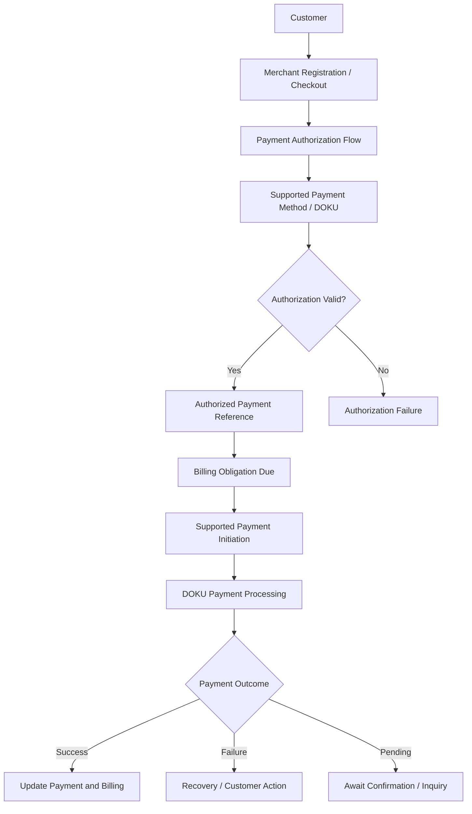
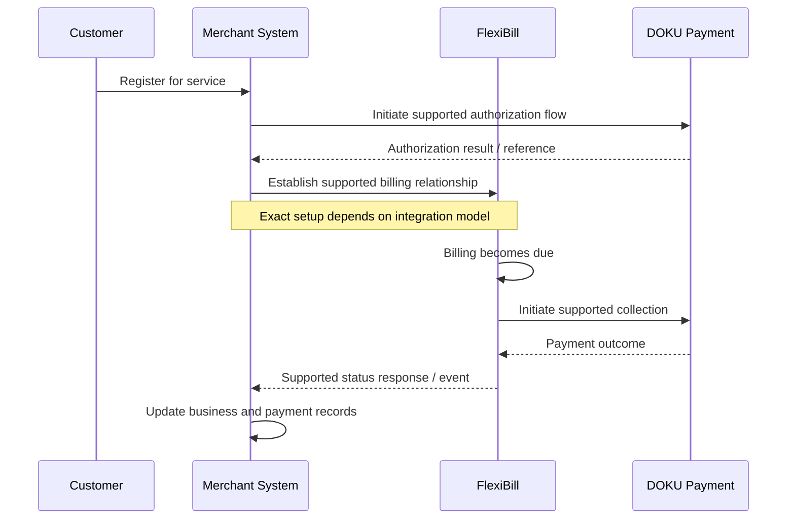

# FlexiBill Payment Authorization & Collection

> Technical and operational guidance for setting up payment authorization, executing recurring collections, managing payment outcomes, and recovering failed payments.

**Audience:** Product, Engineering, Solution Engineering, Implementation, Operations, Business Development  
**Scope:** Indonesia and Malaysia, subject to payment-method and country validation  
**Document status:** Internal implementation reference — current DOKU payment specifications and payment-method rules remain authoritative.

---

## 1. Executive Overview

Recurring collection requires a valid relationship between:

1. A customer.
2. A merchant and commercial agreement.
3. A billing obligation.
4. An accepted payment method.
5. The required customer authorization or mandate.
6. A permitted payment initiation process.
7. A confirmed payment outcome.

FlexiBill connects supported billing workflows with DOKU payment capabilities. The exact authorization and collection journey depends on the payment method, merchant setup, country, and integration model.

**Core principle:** A customer registering for a subscription, a payment credential being stored, and a recurring payment being authorized are distinct events. Do not treat them as interchangeable.

## 2. Authorization-to-Collection Architecture

This is a conceptual flow. Actual authorization mechanisms, credential references, and payment initiation operations vary by payment method and must be confirmed in official DOKU documentation.

## 3. Key Terminology

| Term | Meaning | Important distinction |
|---|---|---|
| Payment method | Instrument or rail used to pay | Does not automatically permit recurring collection |
| Payment credential | Reference or data used in a payment workflow | Storage and use are subject to security rules |
| Token | A provider-managed reference, where applicable | Token behavior and portability must be confirmed |
| Authorization | Customer permission for a defined payment arrangement | Scope, duration, and revocation rules matter |
| Mandate | A payment-method-specific authorization arrangement, where applicable | Requirements differ by payment rail and country |
| Initial payment | First customer payment or setup transaction | May or may not establish recurring authorization |
| Recurring collection | Subsequent permitted payment attempt | Requires valid authorization and supported collection flow |
| Payment attempt | One execution attempt for an obligation | One billing obligation may have multiple attempts |
| Payment result | Outcome of a payment transaction | Must be synchronized with merchant records |

Do not assume all payment methods use tokens or mandates in the same way.

## 4. Authorization Lifecycle

### Stage 1 — Customer disclosure

Before authorization, the customer should understand:
- Merchant identity.
- Product or service being purchased.
- Amount or calculation method.
- Billing frequency.
- First collection date.
- Subsequent collection timing.
- Payment method.
- Cancellation and revocation process.
- Relevant terms and conditions.

The merchant owns the commercial disclosure and consent experience.

### Stage 2 — Customer authentication and authorization

The customer completes the payment-method-specific process.

Depending on the method, this may involve authentication, confirmation, bank approval, card verification, or another approved authorization process.

The exact flow must be confirmed with the relevant DOKU payment-method documentation.

### Stage 3 — Authorization result

The merchant must distinguish:
- Authorization successfully established.
- Authorization pending.
- Authorization failed.
- Authorization expired.
- Authorization revoked or otherwise no longer valid.

These are conceptual categories. Use the actual provider-defined status values in implementation.

### Stage 4 — Credential and reference management

If the payment flow returns a reusable reference, store and manage it according to the documented security requirements.

The merchant must know:
- Which customer it belongs to.
- Which merchant and authorization arrangement it belongs to.
- Which payment method it represents.
- Whether it can be used for recurring collection.
- Its validity and revocation conditions.
- Whether it can be updated or replaced.

Never assume a reference is universally reusable or transferable across merchants, accounts, payment methods, or countries.

## 5. WT and AB Terminology: Validation Required

Internal FlexiBill discussions have referenced two recurring collection terms:

| Term | Internal shorthand | What must be verified |
|---|---|---|
| WT | Token + deduction | Token lifecycle, authorization, request fields, eligibility, and payment behavior |
| AB | Deduction only | Credential or authorization prerequisites, deduction behavior, and eligibility |

These terms are not sufficient to establish the actual technical contract.

Before implementing either flow, confirm:
- Official operation name.
- Supported merchant account type.
- Country availability.
- Payment-method eligibility.
- Required authorization sequence.
- Credential or token requirements.
- Request and response schema.
- Payment status and inquiry mechanism.
- Revocation and renewal behavior.
- Error and retry rules.

Do not infer that AB means no customer authorization is required. Do not infer that WT has identical behavior across all payment methods.

## 6. Recurring Collection Lifecycle

The sequence is illustrative. The actual order and ownership of subscription setup, authorization, and payment initiation must follow the selected integration model.

## 7. Payment Collection Models

| Collection model | Customer interaction | Key requirement |
|---|---|---|
| Customer-initiated payment | Customer actively pays each billing obligation | Payment access and billing reference |
| Authorized recurring collection | Merchant or supported billing workflow initiates subsequent payment | Valid authorization and eligible payment method |
| Initial payment followed by recurring collection | Customer completes initial payment and establishes a permitted recurring arrangement | Confirm whether initial payment also establishes authorization |
| Manual or assisted payment | Customer receives a bill and pays through a supported channel | Correct billing and payment matching |
| Alternative payment after failure | Customer uses another permitted payment method | Correct allocation to the original obligation |

A merchant may use more than one model, but each journey must be designed and tested independently.

## 8. Payment Method Assessment

Payment-method support must be assessed individually.

| Assessment area | Questions |
|---|---|
| Availability | Is the method supported for this merchant and country? |
| Authorization | What customer consent or authentication is required? |
| Recurring eligibility | Can this method support the intended recurring collection? |
| Credential lifecycle | Is a reusable reference created? How is it managed? |
| Collection initiation | Which supported operation initiates subsequent payments? |
| Customer interaction | Does each payment require customer action? |
| Failure behavior | Which failures require customer intervention? |
| Revocation | How does a customer withdraw authorization? |
| Reporting | How are authorization and collection outcomes identified? |

Do not present a payment method as suitable for recurring collection solely because it is available for one-time payments.

## 9. Customer Authorization and Consent Controls

The merchant should maintain evidence of the customer's authorization.

Recommended records include:

| Record | Purpose |
|---|---|
| Customer reference | Identifies the customer |
| Merchant reference | Identifies the merchant |
| Subscription / contract reference | Links authorization to the commercial agreement |
| Payment method | Identifies the applicable payment instrument |
| Authorization reference | Links to the provider-side authorization, where available |
| Consent timestamp | Records when consent was obtained |
| Terms version | Identifies the terms presented to the customer |
| Billing frequency | Records the agreed collection frequency |
| Amount or amount rule | Records the agreed price or calculation method |
| Revocation status | Records whether authorization remains valid |
| Audit reference | Supports investigation and compliance |

The actual mandatory records depend on applicable laws, payment-method rules, and DOKU requirements.

## 10. Credential and Token Management

Where a payment method uses a reusable credential or token, the integration must define:

- Creation and registration.
- Secure storage or provider-side reference management.
- Customer and merchant association.
- Authorization scope.
- Expiration and renewal.
- Revocation.
- Replacement or update.
- Failed collection behavior.
- Data access and deletion.

### Security rules

- Never store raw sensitive payment credentials unless explicitly permitted by the applicable standard and architecture.
- Do not expose tokens or secrets in logs, dashboards, or customer-visible URLs.
- Apply least-privilege access.
- Follow the official DOKU credential-handling requirements.
- Do not assume a token can be migrated to another provider or merchant.

**Migration warning:** Existing payment credentials and mandates must not be assumed portable when a merchant migrates to FlexiBill. The customer may need to complete a new authorization process.

## 11. Payment Collection Execution

Before initiating a collection, validate:

1. Billing obligation exists.
2. Billing amount and currency are correct.
3. Billing is eligible for payment.
4. Customer authorization is valid.
5. Payment method is eligible for the requested transaction.
6. No conflicting payment attempt is unresolved.
7. Duplicate-processing controls are applied.
8. The request uses the correct merchant and billing references.

After initiation:
- Store the transaction reference.
- Interpret the immediate response correctly.
- Await final outcome where required.
- Use supported inquiry or event mechanisms.
- Update the billing record only after the outcome is sufficiently confirmed.

## 12. Payment Failure and Recovery

Payment failures should be classified by their recovery requirements.

| Failure type | Possible cause | Recovery approach |
|---|---|---|
| Authorization failure | Customer did not complete or approve setup | Ask customer to complete the required authorization |
| Expired credential | Payment reference no longer valid | Use the approved update or reauthorization process |
| Revoked authorization | Customer withdrew permission | Stop collection and follow merchant policy |
| Payment decline | Payment method declined the transaction | Apply permitted recovery or customer action |
| Insufficient funds | Funding source lacks sufficient balance | Apply approved retry and notification policy |
| Technical timeout | Outcome uncertain | Verify status before any repeat request |
| Unsupported payment method | Method is not eligible for recurring use | Offer a supported alternative |
| Merchant configuration issue | Incorrect setup or permissions | Correct configuration before resuming |

Do not assume all failure categories are returned as distinct provider error codes.

### Recovery principles

- Never continue collection after confirmed authorization revocation.
- Do not repeatedly retry permanent failures.
- Avoid duplicate collection during uncertain outcomes.
- Keep the original billing obligation traceable across payment attempts.
- Apply merchant-approved retry and customer communication policies.
- Escalate unresolved payment discrepancies.

## 13. Retry and Dunning Considerations

Retry and dunning are related but distinct.

| Process | Purpose |
|---|---|
| Retry | Attempt collection again where permitted |
| Dunning | Manage customer communication and overdue recovery |
| Reauthorization | Restore a valid payment authorization arrangement |
| Alternative payment | Allow payment through another supported method |
| Manual recovery | Resolve an exception through an operational process |

A retry should not be treated as a substitute for authorization renewal or customer consent.

A merchant must define:
- Eligible failure categories.
- Maximum permitted attempts.
- Retry timing.
- Customer notification timing.
- Stop conditions.
- Manual intervention.
- Overdue and service-suspension rules.

Do not assume a universal native retry or dunning policy.

## 14. Customer Payment Experience

A clear customer journey should explain:

1. What service the customer is purchasing.
2. How much will be charged or how the amount is calculated.
3. When payment will occur.
4. Which payment method is authorized.
5. How the customer can review billing.
6. What happens if payment fails.
7. How to update payment details where supported.
8. How to cancel or revoke authorization.

Validate the actual availability of these customer-facing functions in the intended Billing Portal, Member Center, checkout, or merchant application.

## 15. Merchant Operational Controls

| Control | Operational objective |
|---|---|
| Authorization monitoring | Identify expired, revoked, or incomplete authorizations |
| Collection monitoring | Track due obligations and collection outcomes |
| Failure monitoring | Detect payment failures and recurring failure patterns |
| Retry monitoring | Ensure retries follow approved rules |
| Customer communication | Keep customers informed of required actions |
| Reconciliation | Match payment transactions to billing obligations |
| Access control | Restrict who can view or modify sensitive payment references |
| Auditability | Trace authorization and collection decisions |

## 16. Key Performance Indicators

| KPI | Definition | Purpose |
|---|---|---|
| Authorization completion rate | Successfully completed authorizations / authorization attempts | Measures setup effectiveness |
| Authorization validity rate | Valid authorizations / authorizations expected to be active | Measures recurring readiness |
| First-attempt success rate | Successful first collection attempts / first attempts | Measures initial collection quality |
| Overall payment success rate | Successful payment transactions / applicable attempts | Measures payment performance |
| Recovery rate | Recovered failed obligations / eligible failed obligations | Measures recovery effectiveness |
| Authorization failure rate | Failed authorizations / authorization attempts | Identifies setup friction |
| Credential update rate | Updated or reauthorized credentials / eligible cases | Measures recovery of payment references |
| Never-paid rate | Billing obligations with no successful payment / eligible obligations | Identifies unresolved collection leakage |
| Duplicate payment rate | Duplicate successful collections / successful collections | Measures payment control effectiveness |

Define the denominator, reporting period, and exclusion criteria for each metric.

## 17. Testing Strategy

| Scenario | Expected result |
|---|---|
| New customer authorization | Correct authorization workflow |
| Authorization success | Valid reference or result stored securely |
| Authorization failure | No unauthorized recurring collection |
| Authorization pending | No premature activation |
| Recurring collection success | Correct payment and billing update |
| Recurring collection failure | Correct failure classification |
| Revoked authorization | Subsequent collection stopped |
| Expired credential | Approved update or reauthorization process |
| Timeout | Status verified before retry |
| Duplicate request | No unintended duplicate payment |
| Delayed payment result | Merchant state synchronized correctly |
| Customer changes payment method | Old and new references handled safely |
| Merchant migration | Authorization portability not assumed |
| Cross-country setup | Country-specific rules validated |

## 18. Indonesia and Malaysia Validation

For each country, independently confirm:

- Supported recurring payment methods.
- Customer authorization and authentication requirements.
- Token or credential lifecycle.
- WT and AB operation scope, if applicable.
- Merchant eligibility and account setup.
- Payment initiation and status inquiry.
- Webhook coverage.
- Revocation and credential replacement behavior.
- Retry and dunning restrictions.
- Settlement and reconciliation.
- Applicable local regulatory and payment-method rules.

Never assume that a payment method, token, mandate, or recurring operation available in Indonesia is automatically available in Malaysia.

## 19. Known Gaps and Strategic Opportunities

Potential product and integration opportunities include:

- More unified payment-method management.
- Customer self-service payment credential updates.
- Advanced authorization lifecycle monitoring.
- Smarter retry and dunning orchestration.
- Cross-payment-method recovery workflows.
- Centralized recurring payment analytics.
- Better authorization expiry and revocation visibility.
- Improved merchant migration and reauthorization tooling.

These are strategic opportunities, not statements of current native FlexiBill availability.

## 20. Go-Live Checklist

- [ ] Recurring payment method confirmed as supported.
- [ ] Merchant and country eligibility validated.
- [ ] Customer authorization flow approved.
- [ ] Consent and audit requirements documented.
- [ ] Credential lifecycle understood.
- [ ] WT / AB operation contract validated if applicable.
- [ ] Billing-to-payment reference mapping completed.
- [ ] Payment initiation and inquiry tested.
- [ ] Duplicate and timeout controls tested.
- [ ] Revocation and expiry behavior tested.
- [ ] Failure and recovery rules approved.
- [ ] Customer communication approved.
- [ ] Reconciliation and monitoring configured.
- [ ] Support and escalation ownership agreed.

## 21. Related Playbooks

- [Integration Architecture](01-integration-architecture.md)
- [API & H2H Integration](02-api-and-h2h-integration.md)
- [Webhook & Event Management](03-webhook-and-event-management.md)
- [Billing Orchestration](04-billing-orchestration.md)
- [Error Handling & Recovery](06-error-handling-and-recovery.md)
- [Reconciliation & Reporting](07-reconciliation-and-reporting.md)
- [Security & Data Protection](08-security-and-data-protection.md)
- [Testing & Certification](09-testing-and-certification.md)

---

**FlexiBill Payment Authorization & Collection**

*Consent before collection. Authorization before recurring payment. Verified outcomes before business updates.*
