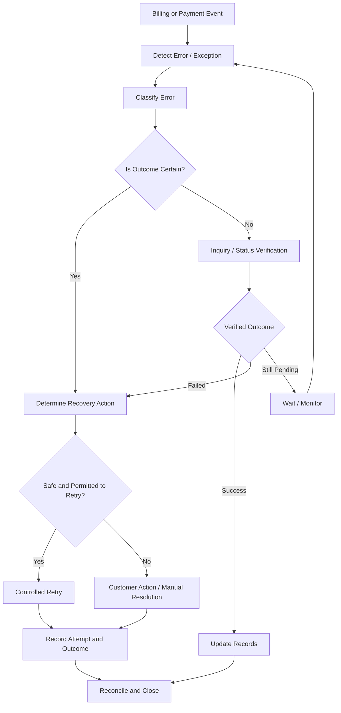
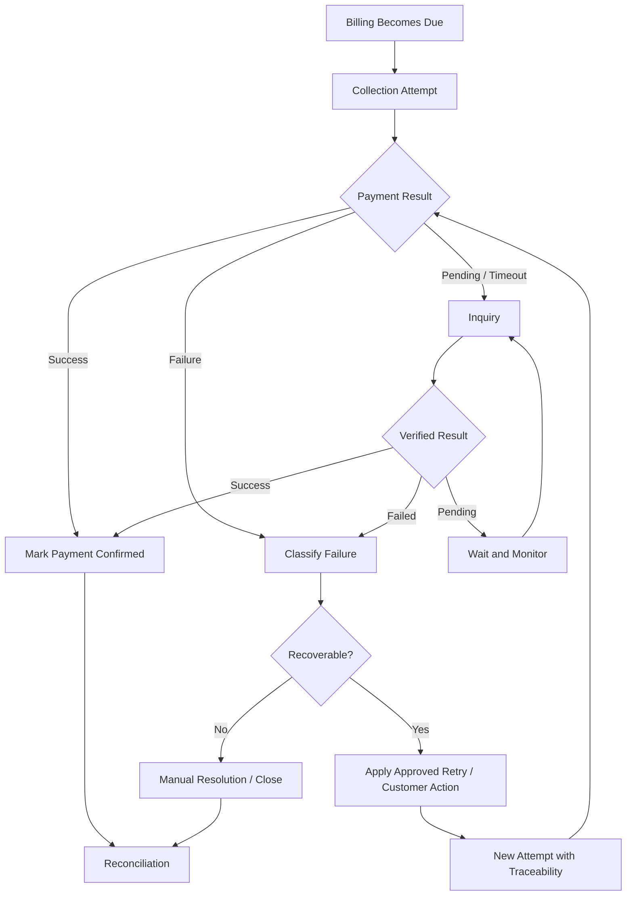

# FlexiBill Error Handling & Recovery

> A practical technical playbook for detecting, classifying, resolving, and preventing errors across FlexiBill billing and payment workflows.

**Audience:** Product, Engineering, Solution Engineering, Implementation, Operations, Customer Support  
**Scope:** Indonesia and Malaysia, subject to country and payment-method validation  
**Document status:** Internal implementation reference

---

## 1. Executive Overview

A billing failure and a payment failure are not necessarily the same event.

A billing obligation may be created correctly while its payment fails. A payment request may time out while the payment is actually successful. A webhook may be delayed even though the provider has completed the transaction.

FlexiBill integrations must therefore distinguish:

- Billing configuration errors.
- Billing generation and scheduling errors.
- Customer and subscription data errors.
- Authorization errors.
- Payment processing failures.
- Technical communication failures.
- Asynchronous event failures.
- Reconciliation discrepancies.

**Core principle: Never interpret an uncertain payment outcome as a confirmed failure, and never retry a payment blindly.**

## 2. Error Management Architecture

This is a conceptual operating model. The actual inquiry operations and retry controls depend on the selected DOKU integration and payment method.

## 3. Error Classification Framework

| Category | Examples | Primary owner |
|---|---|---|
| Configuration | Invalid Collection, Plan, pricing, or merchant setup | Merchant / Implementation |
| Billing data | Missing customer, incorrect amount, invalid billing reference | Merchant / Integration |
| Scheduling | Billing not generated or generated at the wrong time | Billing owner / Engineering |
| Authorization | Expired, revoked, incomplete authorization | Merchant / Payment Operations |
| Payment business failure | Decline, insufficient funds, unsupported method | Payment Operations |
| Technical failure | Timeout, connectivity failure, service unavailability | Engineering / Provider |
| API contract | Invalid schema, missing required field, invalid request | Integration Engineering |
| Webhook / event | Missing, delayed, duplicated, or incorrectly processed event | Integration Engineering |
| Reconciliation | Billing and payment records do not match | Finance / Operations |
| Security | Invalid credentials, access denial, suspected compromise | Security / Engineering |

An exception may involve more than one category. Record the primary cause and any contributing causes separately.

## 4. Billing Errors vs Payment Errors

| Dimension | Billing error | Payment error |
|---|---|---|
| What failed? | Creation or management of the billing obligation | Collection or payment processing |
| Example | Incorrect amount or billing schedule | Payment decline |
| Billing record | May be missing or incorrect | May remain valid and payable |
| Payment attempt | May never have started | May have been initiated |
| Recovery | Correct configuration or billing data | Inquiry, customer action, or permitted retry |
| Main risk | Incorrect or missing obligation | Duplicate collection or unresolved payment |

Do not regenerate a billing obligation merely because its payment attempt failed.

## 5. Error Lifecycle and State Management

Use separate state dimensions for billing, payment, and authorization.

### Billing obligation

Conceptual states:
- Draft or configured.
- Scheduled.
- Due.
- Overdue.
- Paid.
- Cancelled or closed.

### Payment attempt

Conceptual states:
- Created.
- Submitted.
- Pending.
- Successful.
- Failed.
- Expired or unresolved, where supported.

### Authorization

Conceptual states:
- Not established.
- Pending.
- Active or valid.
- Expired.
- Revoked.
- Failed.

These are logical categories, not guaranteed DOKU status values. Map them to the actual provider and FlexiBill status definitions.

**Important:** A failed payment attempt does not automatically mean the billing obligation is cancelled. A successful payment does not automatically mean every downstream merchant entitlement or accounting process has completed.

## 6. The Most Important Rule: Pending Is Not Failed

A timeout or missing response creates uncertainty.

Example:

1. Merchant submits a payment request.
2. DOKU receives and processes the request.
3. Network timeout occurs before the merchant receives the response.
4. Merchant cannot determine whether the payment succeeded.

The merchant must not immediately submit a new independent payment request.

Recommended handling:

1. Preserve the original request reference.
2. Record the timeout.
3. Check the transaction using the supported inquiry mechanism.
4. Process the verified result.
5. Retry only if the original attempt is confirmed unsuccessful and another attempt is permitted.

This prevents duplicate collection.

## 7. Error Handling Matrix

| Error scenario | Immediate action | Recovery |
|---|---|---|
| Invalid request | Stop submission | Correct request schema or data |
| Missing required field | Stop submission | Complete required data |
| Invalid merchant configuration | Stop affected workflow | Correct merchant setup |
| Authorization failure | Do not collect | Complete required authorization |
| Authorization revoked | Stop recurring collection | Obtain valid new authorization if customer agrees |
| Payment declined | Record failure | Follow permitted recovery policy |
| Insufficient funds | Record failure | Customer action or approved retry |
| Timeout | Preserve original reference | Inquiry before retry |
| Provider unavailable | Queue or defer where safe | Controlled resubmission after verification |
| Duplicate request | Check original transaction | Return or process original result safely |
| Webhook not received | Do not assume payment failed | Inquiry and event reconciliation |
| Webhook duplicated | Deduplicate event | Process once |
| Out-of-order event | Validate current state | Apply safe state transition |
| Billing amount mismatch | Stop affected processing | Reconcile source calculation |
| Customer not found | Stop affected processing | Correct customer mapping |
| Settlement discrepancy | Open reconciliation case | Finance / provider investigation |

The table describes recommended handling. Exact error codes and response messages must come from official DOKU specifications.

## 8. Idempotency and Duplicate Protection

Idempotency is a key control for safe payment processing.

Where the API supports idempotency:
- Use the documented idempotency mechanism.
- Reuse the same key for retries of the same logical request, according to the provider contract.
- Do not create a new key simply because the original request timed out.
- Store request and transaction references.
- Prevent concurrent duplicate collection attempts for the same obligation.

Where idempotency is not explicitly supported:
- Implement merchant-side duplicate controls.
- Use the original transaction reference for inquiry.
- Apply locking or concurrency controls around payment initiation.
- Confirm the provider's recommended duplicate handling.

Never invent an idempotency header, field, or key format.

## 9. Retry Strategy

A retry is a new attempt to resolve an eligible failure. It must be controlled and traceable.

### Retry decision matrix

| Condition | Retry decision | Action |
|---|---|---|
| Confirmed temporary technical failure | Conditional | Retry according to provider guidance |
| Confirmed payment decline | Conditional | Apply method-specific recovery policy |
| Insufficient funds | Conditional | Customer communication and permitted retry |
| Invalid request | No | Correct request first |
| Revoked authorization | No | Stop until valid authorization is established |
| Expired credential | No immediate retry | Complete approved update or reauthorization |
| Unsupported payment method | No | Offer a supported method |
| Unknown transaction outcome | No blind retry | Inquiry first |
| Duplicate successful payment | No | Stop and investigate |

### Retry policy dimensions

The merchant and implementation team must define:

- Eligible error categories.
- Maximum attempts.
- Retry intervals.
- Business-day and calendar-day treatment.
- Customer notification timing.
- Stop conditions.
- Manual escalation.
- Service suspension or cancellation rules.

Do not assume FlexiBill has one universal native retry schedule for every merchant and payment method.

## 10. Recovery Workflow

### Recovery ownership

| Recovery activity | Typical owner |
|---|---|
| Correct billing configuration | Merchant / Implementation |
| Correct customer or billing data | Merchant |
| Resolve API integration failure | Engineering |
| Verify uncertain payment | Payment Operations / Engineering |
| Reauthorize payment method | Customer / Merchant |
| Approve retry policy | Merchant business owner |
| Investigate settlement discrepancy | Finance / Operations |
| Handle provider-side issue | DOKU support / relevant operations team |

## 11. Webhook and Event Failure Handling

Webhooks are asynchronous notifications and should not be the only source of truth for unresolved transactions.

Recommended controls:

- Validate event authenticity using the documented mechanism.
- Persist the incoming event before processing.
- Deduplicate repeated events.
- Support delayed event delivery.
- Handle out-of-order events.
- Make event processing safe to repeat.
- Track failed event processing.
- Implement controlled replay or reconciliation.
- Use transaction inquiry when event status is missing or ambiguous.

Do not assume a webhook is delivered exactly once or in chronological order.

Refer to `03-webhook-and-event-management.md` for the detailed event-processing design.

## 12. Billing Data and Configuration Recovery

Payment recovery cannot compensate for incorrect billing data.

Before restarting a failed billing workflow, verify:

- Customer identity.
- Billing reference.
- Collection and Plan association.
- Pricing and amount.
- Currency.
- Billing date and schedule.
- Subscription or membership status.
- Payment authorization.
- Merchant account configuration.

If the billing amount is wrong, correct the source of the billing obligation before attempting payment again.

Maintain an audit trail for changes to billing amounts and schedules.

## 13. Customer Communication

Customer communications should be triggered by the actual business condition, not by a technical timeout alone.

| Condition | Recommended communication |
|---|---|
| Authorization incomplete | Explain how to complete setup |
| Payment confirmed successful | Provide confirmation or receipt where supported |
| Payment confirmed failed | Explain the required customer action |
| Payment outcome pending | Avoid telling the customer that payment definitely failed |
| Credential expired | Explain how to update or reauthorize |
| Authorization revoked | Confirm that recurring collection has stopped |
| Billing data correction required | Explain the corrected amount or schedule |

Messages should identify the merchant, billing obligation, amount, due date, and available next action where appropriate.

Do not disclose sensitive payment information.

## 14. Monitoring and Alerting

Recommended monitoring dimensions:

| Metric | What it detects |
|---|---|
| API error rate | Integration instability |
| Timeout rate | Uncertain payment outcomes |
| Pending transaction age | Unresolved transactions |
| Payment decline rate | Payment performance deterioration |
| Authorization failure rate | Registration friction |
| Duplicate attempt rate | Payment control weaknesses |
| Webhook delivery / processing failure | Event synchronization issues |
| Billing generation failure rate | Billing workflow defects |
| Retry recovery rate | Effectiveness of recovery policy |
| Unmatched transaction count | Reconciliation problems |

Alert thresholds should be set based on baseline traffic, service objectives, and operational capacity.

### Suggested alert severity

- **Critical:** Risk of duplicate charging, security incident, widespread collection outage.
- **High:** Significant payment failure spike, billing generation disruption, authorization outage.
- **Medium:** Elevated webhook delays, isolated integration failures, growing pending backlog.
- **Low:** Individual data issues or recoverable merchant configuration exceptions.

These severity categories are recommended internal conventions, not official DOKU incident classifications.

## 15. Operational Incident Runbook

For a significant incident:

1. Identify the affected merchant, country, payment method, and workflow.
2. Establish the time window and scope.
3. Stop unsafe repeat processing if duplicate collection is possible.
4. Preserve request, transaction, billing, and event references.
5. Identify whether billing, authorization, payment, or event processing is affected.
6. Verify uncertain transaction outcomes.
7. Engage the responsible technical or operational owner.
8. Communicate confirmed business impact.
9. Apply a controlled recovery plan.
10. Reconcile all affected billing obligations and payment attempts.
11. Document root cause and corrective actions.

### Incident record template

| Field | Required information |
|---|---|
| Incident ID | Internal tracking reference |
| Merchant | Affected merchant |
| Country | Indonesia / Malaysia |
| Payment method | Affected method |
| Time window | Start and end |
| Impact | Billing and payment impact |
| Error category | Primary classification |
| Transaction references | Relevant identifiers |
| Immediate mitigation | Actions taken |
| Root cause | Confirmed cause |
| Recovery | Resolution |
| Follow-up | Preventive actions |

## 16. Indonesia and Malaysia Validation

Validate independently for each country:

- Supported payment methods and recurring eligibility.
- API response and error definitions.
- Inquiry and transaction status behavior.
- Webhook coverage and delivery behavior.
- Idempotency and duplicate-processing support.
- Authorization expiry and revocation.
- Retry restrictions and payment-method rules.
- Settlement and reconciliation timing.
- Local operational escalation procedures.

Do not assume identical error codes, response behavior, retry permissions, or payment-method availability across Indonesia and Malaysia.

## 17. Known Gaps and Strategic Opportunities

Potential product opportunities:

- Centralized exception dashboard.
- Unified billing and payment error taxonomy.
- Configurable recovery orchestration.
- Intelligent retry recommendations.
- Automated pending-transaction resolution.
- Merchant-visible payment exception queue.
- Customer self-service recovery.
- Cross-payment-method recovery.
- Root-cause analytics and revenue leakage monitoring.

These are strategic opportunities, not assertions that the capabilities are currently native FlexiBill features.

## 18. Go-Live Checklist

- [ ] Error categories and ownership documented.
- [ ] Billing and payment states mapped separately.
- [ ] Pending and timeout handling implemented.
- [ ] Inquiry mechanism validated.
- [ ] Idempotency support confirmed.
- [ ] Duplicate request protection tested.
- [ ] Retry eligibility and limits approved.
- [ ] Authorization expiry and revocation tested.
- [ ] Webhook deduplication implemented.
- [ ] Out-of-order event handling tested.
- [ ] Customer communication approved.
- [ ] Monitoring and alerting configured.
- [ ] Incident escalation owners assigned.
- [ ] Reconciliation process tested.
- [ ] Indonesia and Malaysia differences validated.

## 19. Related Playbooks

- [Integration Architecture](01-integration-architecture.md)
- [API & H2H Integration](02-api-and-h2h-integration.md)
- [Webhook & Event Management](03-webhook-and-event-management.md)
- [Billing Orchestration](04-billing-orchestration.md)
- [Payment Authorization & Collection](05-payment-authorization-and-collection.md)
- [Reconciliation & Reporting](07-reconciliation-and-reporting.md)
- [Security & Data Protection](08-security-and-data-protection.md)
- [Testing & Certification](09-testing-and-certification.md)
- [Technical Solution Patterns](10-technical-solution-patterns.md)

---

**FlexiBill Error Handling & Recovery**

*Classify before acting. Verify before retrying. Reconcile before closing.*
