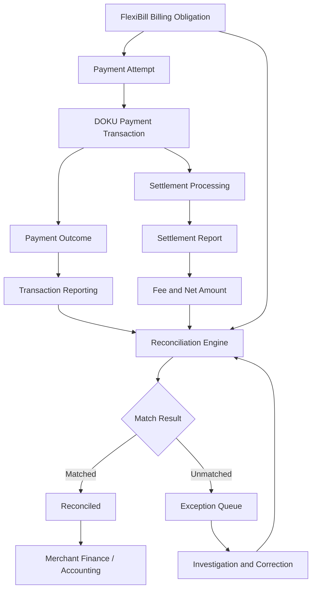
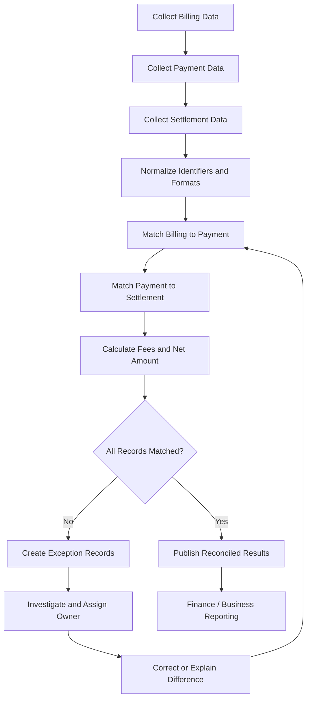

# FlexiBill Reconciliation & Reporting

> A practical playbook for matching billing obligations, payment transactions, settlement records, fees, and merchant financial records across FlexiBill and DOKU integrations.

**Audience:** Product, Engineering, Finance, Reconciliation Operations, Implementation, Merchant Operations  
**Scope:** Indonesia and Malaysia, subject to payment-method and settlement validation  
**Document status:** Internal implementation reference

---

## 1. Executive Overview

Reconciliation is the process of verifying that billing obligations, payment transactions, and financial movements are correctly matched and accounted for.

In FlexiBill, these are related but distinct records:

1. **Billing obligation:** What the customer is required to pay.
2. **Payment attempt:** An attempt to collect that obligation.
3. **Payment transaction:** The transaction processed through the payment infrastructure.
4. **Settlement:** The financial movement to the merchant according to the applicable settlement arrangement.
5. **Fee:** The applicable payment processing or commercial charge.
6. **Accounting record:** The merchant's financial recognition and ledger entry.

A billing obligation can be paid while its settlement is still pending. A payment can succeed while the merchant's internal billing record remains outdated. A settlement can contain multiple transactions.

**Core principle: Never treat billing status, payment status, and settlement status as interchangeable.**

## 2. Reconciliation Architecture



This is a conceptual architecture. The exact reporting sources, identifiers, settlement files, and available interfaces depend on the merchant's DOKU arrangement.

## 3. Reconciliation Record Types

| Record | What it represents | Primary question |
|---|---|---|
| Billing obligation | Amount due from customer | What should be collected? |
| Payment attempt | An execution attempt | How many collection attempts occurred? |
| Payment transaction | Payment processed by the provider | Was the transaction successful? |
| Refund / reversal | Financial correction or return | Was a previous payment reversed or refunded? |
| Settlement record | Financial movement to merchant | Was the transaction settled? |
| Fee record | Processing or commercial fee | What fee was applied? |
| Accounting entry | Merchant financial record | Was the movement recorded correctly? |

These records should remain individually traceable.

## 4. Identifier and Data Mapping

Do not assume that one billing identifier equals one payment transaction identifier.

A single billing obligation may have multiple payment attempts. A payment transaction may also have its own provider-side identifier.

Recommended mapping:

| Identifier | Purpose | Ownership / source |
|---|---|---|
| Customer ID | Identifies the customer | Merchant / Member Center |
| Subscription or membership ID | Identifies the recurring relationship | FlexiBill / merchant |
| Billing ID | Identifies the billing obligation | FlexiBill / billing source |
| Invoice ID | Identifies the invoice, where applicable | Billing system |
| Payment attempt ID | Identifies an individual collection attempt | Integration / billing workflow |
| DOKU transaction reference | Identifies provider-side payment processing | DOKU |
| Merchant order/reference ID | Connects payment to merchant records | Merchant |
| Settlement reference | Identifies settlement grouping or movement | Settlement reporting |
| Refund reference | Identifies a refund or reversal | Payment / settlement reporting |

Actual field names and availability must be confirmed against the relevant API and report specifications.

### Recommended relationship

```text
Customer
  └── Subscription / Membership
        └── Billing Obligation
              ├── Payment Attempt 1
              │     └── DOKU Transaction Reference A
              ├── Payment Attempt 2
              │     └── DOKU Transaction Reference B
              └── Final Payment Outcome
                    └── Settlement Record(s)
```

Maintain an auditable relationship between the original billing obligation and every associated payment attempt.

## 5. Three Layers of Reconciliation

### Layer 1 — Billing to Payment

Question: Did the customer successfully pay the amount due?

Compare:
- Billing ID.
- Invoice reference.
- Customer reference.
- Billing amount and currency.
- Payment attempt.
- Payment transaction reference.
- Final payment outcome.

Possible results:
- Fully matched.
- Partially paid, where supported by the business process.
- Overpaid.
- Unpaid.
- Duplicate payment.
- Unmatched payment.
- Amount mismatch.

### Layer 2 — Payment to Settlement

Question: Did the successful transaction result in the expected settlement?

Compare:
- DOKU transaction reference.
- Payment amount.
- Payment status.
- Settlement reference.
- Gross amount.
- Fee.
- Net amount.
- Settlement date.
- Settlement currency.

A successful payment is not automatically proof that the merchant has received settlement.

### Layer 3 — Settlement to Accounting

Question: Was the financial movement recorded correctly in the merchant's ledger?

Compare:
- Settlement amount.
- Applicable fees.
- Refunds and reversals.
- Adjustments.
- Bank statement or settlement account movement.
- Accounting entry.
- Financial reporting period.

The merchant's finance or accounting system remains responsible for its accounting treatment.

## 6. Reconciliation Matching Logic

Use a controlled matching hierarchy.

| Priority | Matching approach | Purpose |
|---|---|---|
| 1 | Exact DOKU transaction reference | Strong transaction-level match |
| 2 | Exact merchant reference | Connects provider transaction to merchant record |
| 3 | Billing ID / invoice reference | Connects transaction to billing obligation |
| 4 | Amount + currency + date window | Supports investigation when references are missing |
| 5 | Manual investigation | Resolves ambiguous or conflicting records |

Amount and date alone should not be treated as conclusive proof of a match.

### Matching outcomes

| Outcome | Definition | Action |
|---|---|---|
| Matched | Expected records align | Close reconciliation item |
| Missing payment | Billing obligation has no corresponding successful payment | Investigate collection |
| Missing billing | Payment exists without a matching billing obligation | Investigate reference mapping |
| Amount mismatch | Billing and payment amounts differ | Investigate amount calculation or adjustment |
| Duplicate payment | Multiple successful transactions appear against one obligation | Review customer impact and refund policy |
| Settlement pending | Payment is successful but settlement is not yet matched | Monitor according to settlement timing |
| Settlement mismatch | Settlement amount or fee differs from expectation | Finance / provider investigation |
| Refund mismatch | Refund and original transaction do not reconcile | Investigate refund lifecycle |
| Unidentified | Insufficient data to establish a reliable match | Manual exception queue |

## 7. Gross, Fee, and Net Amount

Keep the financial components separate.

Conceptual calculation:

```text
Gross Transaction Amount
- Applicable Payment Fees
+/- Applicable Adjustments
= Expected Net Settlement
```

The actual calculation depends on the applicable commercial agreement, payment method, tax treatment, refund, reversal, and settlement rules.

### Illustrative example

| Component | Amount |
|---|---:|
| Customer payment | Rp1,000,000 |
| Illustrative payment fee | Rp25,000 |
| Illustrative net settlement | Rp975,000 |

This example is for explanation only. It is not a DOKU tariff or settlement commitment.

Do not assume that all fees are deducted from the same settlement, or that every payment method follows the same fee calculation.

## 8. Payment Success vs Settlement Success

| Dimension | Payment success | Settlement success |
|---|---|---|
| Meaning | Payment transaction has succeeded | Funds have been settled according to the applicable arrangement |
| Primary source | Transaction result / inquiry / event | Settlement report or settlement record |
| Timing | At payment processing | According to settlement cycle |
| Merchant action | Update payment and billing records | Reconcile financial receipt |
| Key risk | Incorrect payment status | Missing or mismatched financial movement |

A payment transaction may be successful but not yet included in an available settlement report.

Do not mark settlement as complete merely because the payment transaction succeeded.

## 9. Refunds, Reversals, and Adjustments

Refunds, reversals, and adjustments must be recorded separately from the original payment.

Recommended fields:
- Original transaction reference.
- Refund or reversal reference.
- Billing ID or invoice reference.
- Original amount.
- Refunded or reversed amount.
- Currency.
- Reason.
- Processing status.
- Relevant timestamps.
- Settlement impact.
- Merchant accounting reference.

### Important controls

- Avoid treating a refund as a new successful payment.
- Do not delete or overwrite the original transaction record.
- Preserve the link between original and corrective transactions.
- Reconcile partial refunds separately where supported.
- Confirm how the relevant payment method reports reversals and refunds.

## 10. Reconciliation Data Model

A useful internal reporting model should include:

| Data group | Recommended fields |
|---|---|
| Merchant | Merchant ID, merchant name, country |
| Customer | Customer ID, customer reference |
| Billing | Billing ID, invoice ID, due date, billing amount |
| Subscription | Subscription ID, plan, billing cycle |
| Payment | Attempt ID, transaction reference, payment method |
| Payment outcome | Status, response category, result timestamp |
| Financial | Gross amount, currency, fee, net amount |
| Settlement | Settlement reference, settlement date, settlement status |
| Adjustment | Refund / reversal reference, amount, status |
| Audit | Source system, extraction timestamp, last update |

Use actual available source fields. This table is a target data model, not a claim that every field exists in every DOKU report.

## 11. Reporting Architecture

Recommended reporting layers:

### Operational reporting
For daily payment and billing operations:
- Due obligations.
- Successful collections.
- Failed collections.
- Pending transactions.
- Retry attempts.
- Authorization exceptions.
- Unmatched billing records.

### Financial reconciliation reporting
For Finance and Operations:
- Successful transaction amount.
- Settlement amount.
- Fees.
- Net settlement.
- Refunds and reversals.
- Settlement pending.
- Unmatched records.

### Business performance reporting
For Product and Business:
- Active subscriptions.
- Billing volume.
- Payment success rate.
- Revenue collection.
- Recovery rate.
- Never-paid billing obligations.
- Revenue leakage.
- Merchant and payment-method performance.

### Strategic analytics
For product and portfolio decisions:
- Cohort renewal and persistency.
- Failed-payment patterns.
- Payment-method mix.
- Collection timing.
- Merchant segmentation.
- Recovery effectiveness.
- Country-level performance.

## 12. Recommended Reconciliation Workflow



### Recommended operating cadence

The reconciliation frequency should reflect transaction volume, settlement arrangements, and operational requirements.

A typical design may include:
- Near-real-time operational monitoring.
- Daily transaction reconciliation.
- Settlement-cycle reconciliation.
- Period-end financial reconciliation.

These are recommended operating patterns, not mandatory DOKU schedules.

## 13. Exception Management

Each unmatched record should have an owner, status, reason, and resolution history.

| Exception | Suggested owner | Resolution |
|---|---|---|
| Billing without successful payment | Merchant Operations | Verify collection and recovery |
| Payment without billing match | Integration / Operations | Correct reference mapping |
| Duplicate payment | Payment Operations | Investigate and apply approved resolution |
| Amount mismatch | Merchant / Finance | Verify pricing, taxes, and adjustments |
| Settlement missing | Finance / DOKU Operations | Check settlement cycle and provider report |
| Fee mismatch | Finance | Verify commercial agreement |
| Refund mismatch | Payment Operations | Trace original and refund records |
| Missing report row | Reporting / Engineering | Verify extraction and source completeness |

### Exception record template

| Field | Description |
|---|---|
| Exception ID | Unique internal reference |
| Merchant | Affected merchant |
| Country | Indonesia / Malaysia |
| Billing ID | Related billing obligation |
| Transaction reference | Related payment transaction |
| Settlement reference | Related settlement record |
| Exception type | Mismatch category |
| Amount | Disputed or unmatched amount |
| First detected | Initial detection time |
| Owner | Responsible team |
| Status | Open / Investigating / Resolved |
| Root cause | Confirmed explanation |
| Resolution | Corrective action |

## 14. Key Reconciliation KPIs

| KPI | Definition | Business value |
|---|---|---|
| Billing-to-payment match rate | Matched billing obligations / eligible billing obligations | Measures collection traceability |
| Payment-to-settlement match rate | Matched payment transactions / eligible successful transactions | Measures settlement completeness |
| Unmatched transaction rate | Unmatched payment transactions / eligible payment transactions | Detects reconciliation gaps |
| Settlement variance | Expected net settlement minus actual matched settlement | Measures financial discrepancy |
| Duplicate payment rate | Duplicate successful payments / successful payments | Measures payment control |
| Refund reconciliation rate | Matched refund records / refund records | Measures refund traceability |
| Reconciliation completion time | Time from source availability to reconciliation closure | Measures operational efficiency |
| Open exception ageing | Time unresolved exceptions remain open | Measures operational backlog |
| Fee variance | Expected fee minus actual fee | Detects commercial or data mismatch |

Every KPI must have a clearly defined reporting period, denominator, data source, and exclusion rule.

## 15. Data Quality and Reporting Controls

Before publishing reports, validate:

- Completeness of source data.
- Uniqueness of identifiers.
- Consistency of currency and decimal formats.
- Timezone and timestamp handling.
- Duplicate records.
- Missing or delayed records.
- Status mapping.
- Amount calculation.
- Fee and tax treatment.
- Pagination and export completeness.
- Extraction and refresh timestamps.

Preserve the original source data or an auditable reference to it. Do not silently overwrite historical reconciliation results.

## 16. Indonesia and Malaysia Validation

Validate separately:

| Area | Indonesia | Malaysia |
|---|---|---|
| Payment methods | Confirm actual merchant eligibility | Confirm actual merchant eligibility |
| Transaction identifiers | Validate source fields | Validate source fields |
| Settlement reporting | Confirm report format and cycle | Confirm report format and cycle |
| Fee treatment | Validate commercial agreement | Validate commercial agreement |
| Currency | Confirm applicable transaction currency | Confirm applicable transaction currency |
| Refund / reversal | Validate reporting behavior | Validate reporting behavior |
| Timezone | Confirm source timestamp convention | Confirm source timestamp convention |
| Export / API | Confirm supported access | Confirm supported access |

Do not assume identical reports, settlement timing, fees, currencies, or reconciliation interfaces across countries.

## 17. Known Gaps and Strategic Opportunities

Potential product opportunities:

- Unified billing-to-payment-to-settlement dashboard.
- Automated exception matching.
- Merchant-level reconciliation exports.
- Automated fee and net settlement analysis.
- Cross-country reconciliation analytics.
- Refund and reversal lifecycle visibility.
- Revenue leakage monitoring.
- Cohort-based collection reporting.
- Finance-ready reconciliation APIs.
- Automated exception assignment and resolution tracking.

These are strategic opportunities, not statements of current native FlexiBill functionality.

## 18. Go-Live Checklist

- [ ] Billing and payment identifiers mapped.
- [ ] Payment attempt and transaction relationship defined.
- [ ] Transaction reporting source confirmed.
- [ ] Settlement reporting source confirmed.
- [ ] Fee calculation validated.
- [ ] Gross and net amount definitions agreed.
- [ ] Refund and reversal handling tested.
- [ ] Timezone and currency rules confirmed.
- [ ] Matching hierarchy implemented.
- [ ] Exception categories and owners assigned.
- [ ] Daily and period-end processes agreed.
- [ ] Reporting completeness validated.
- [ ] Finance sign-off obtained.
- [ ] Indonesia and Malaysia differences validated.

## 19. Related Playbooks

- [Integration Architecture](01-integration-architecture.md)
- [API & H2H Integration](02-api-and-h2h-integration.md)
- [Webhook & Event Management](03-webhook-and-event-management.md)
- [Billing Orchestration](04-billing-orchestration.md)
- [Payment Authorization & Collection](05-payment-authorization-and-collection.md)
- [Error Handling & Recovery](06-error-handling-and-recovery.md)
- [Security & Data Protection](08-security-and-data-protection.md)
- [Testing & Certification](09-testing-and-certification.md)
- [Technical Solution Patterns](10-technical-solution-patterns.md)

---

**FlexiBill Reconciliation & Reporting**

*One billing obligation. Traceable payment attempts. Verified settlement. Reconciled financial records.*
