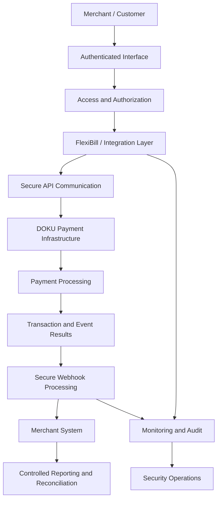
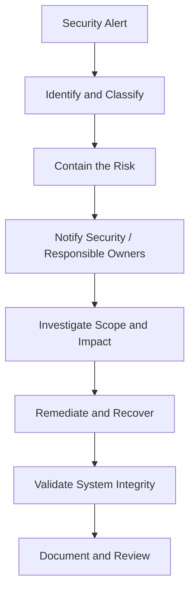

# FlexiBill Security & Data Protection

> Security and data protection guidance for FlexiBill billing, subscription, payment, API, webhook, and merchant integration workflows.

**Audience:** Product, Engineering, Security, Compliance, Legal, Solution Engineering, Implementation, Operations  
**Scope:** Indonesia and Malaysia  
**Document status:** Internal security reference — subject to DOKU security standards, applicable regulations, contractual obligations, and formal security review.

---

## 1. Executive Overview

FlexiBill processes and orchestrates billing-related information that may include customer identities, subscription records, invoices, payment references, transaction information, and integration credentials.

Security must protect the entire lifecycle:

1. Merchant onboarding and access.
2. Customer registration and consent.
3. Billing and subscription configuration.
4. API communication.
5. Payment authorization and collection.
6. Webhook and event processing.
7. Reporting and reconciliation.
8. Data retention and deletion.
9. Incident detection and response.

**Core principle: Protect customer data, payment credentials, merchant access, and transaction integrity at every integration boundary.**

This document provides recommended design controls. It does not replace DOKU's formal security policies, PCI requirements, country-specific legal assessments, or contractual obligations.

## 2. Security Architecture



The architecture should apply security controls at every boundary, including merchant applications, DOKU interfaces, internal services, and operational tools.

## 3. Security Principles

| Principle | Meaning | Expected control |
|---|---|---|
| Least privilege | Users and systems receive only necessary access | Role-based permissions |
| Defense in depth | Multiple layers of security | Authentication, authorization, monitoring |
| Data minimization | Collect only required information | Minimize personal data fields |
| Secure by design | Security considered from architecture stage | Threat assessment and secure development |
| Confidentiality | Protect data from unauthorized disclosure | Encryption and access restrictions |
| Integrity | Prevent unauthorized changes | Validation, audit trails, controlled updates |
| Availability | Keep critical workflows operational | Resilience and incident procedures |
| Accountability | Make important actions traceable | Logs and audit records |
| Privacy by design | Consider privacy throughout data lifecycle | Purpose limitation and retention controls |

## 4. Identity and Access Management

Access should be controlled for both human users and system integrations.

### Merchant and operational access

Recommended controls:
- Unique user identities.
- Role-based access control.
- Least-privilege permissions.
- Appropriate authentication strength.
- Multi-factor authentication where required by DOKU policy.
- Periodic access reviews.
- Timely removal of inactive or unauthorized users.
- Audit logs for privileged actions.

### Suggested role separation

| Role | Typical access |
|---|---|
| Merchant administrator | Merchant-level configuration |
| Billing operator | Billing and subscription operations |
| Finance operator | Payment and reconciliation reports |
| Support operator | Limited customer and transaction investigation |
| Integration administrator | API and integration configuration |
| DOKU platform administrator | Platform-level controls under internal policy |

Actual roles and permissions must follow the deployed DOKU product and access-control model.

## 5. API Credential and Secret Management

API credentials and integration secrets must be protected throughout their lifecycle.

### Recommended controls

- Store secrets in an approved secrets-management system.
- Do not hardcode credentials in source code.
- Never commit production secrets to GitHub.
- Separate development, testing, and production credentials.
- Restrict access to authorized services and personnel.
- Rotate credentials according to approved policy.
- Revoke credentials when compromised or no longer required.
- Avoid exposing secrets in logs, error messages, screenshots, or support tickets.
- Use secure deployment and configuration processes.

### Credential lifecycle

```text
Provision
   ↓
Secure Storage
   ↓
Controlled Access
   ↓
Use in Authorized Integration
   ↓
Monitoring and Review
   ↓
Rotation / Revocation
   ↓
Secure Decommissioning
```

Do not invent or assume specific credential formats, rotation intervals, or authentication headers. Follow the official DOKU integration specification.

## 6. Payment Data and Token Protection

Payment credentials and reusable payment references require careful handling.

### Data handling principles

- Do not store raw sensitive payment credentials unless explicitly permitted by the applicable standard and approved architecture.
- Use provider-supported tokenization or credential-reference mechanisms where available.
- Treat tokens and payment references as sensitive information.
- Restrict access to credential references.
- Do not expose credentials in URLs, logs, or customer-visible reports.
- Avoid transmitting payment information through unapproved communication channels.
- Apply the documented DOKU payment-data handling requirements.

### Token and authorization distinction

A payment token or reference does not automatically prove that recurring authorization is valid.

The implementation must separately understand:
- Credential or token validity.
- Customer authorization status.
- Payment-method eligibility.
- Merchant and country restrictions.
- Revocation and expiry behavior.

Refer to `05-payment-authorization-and-collection.md`.

## 7. Customer Data Protection

FlexiBill-related information may include:
- Customer identifiers.
- Name and contact information.
- Membership or subscription information.
- Billing history.
- Invoice details.
- Payment references.
- Transaction outcomes.
- Customer support records.

### Recommended controls

| Control | Purpose |
|---|---|
| Data minimization | Reduce unnecessary personal data collection |
| Purpose limitation | Use data only for authorized purposes |
| Access restriction | Limit access to authorized personnel |
| Encryption | Protect data in transit and at rest according to approved standards |
| Retention policy | Avoid keeping information longer than permitted |
| Secure deletion | Follow approved deletion and disposal procedures |
| Auditability | Trace access and changes |
| Data accuracy | Support correction of inaccurate records |
| Environment separation | Avoid unnecessary production-data exposure in testing |

The actual personal data classification and mandatory controls must be determined by DOKU's security and privacy governance.

## 8. Data Classification

A recommended internal classification model:

| Classification | Examples | Handling |
|---|---|---|
| Public | Approved public product information | May be shared publicly |
| Internal | Internal playbooks and non-sensitive process documentation | Internal access |
| Confidential | Merchant information, transaction reports, customer records | Restricted access |
| Restricted | Secrets, sensitive credentials, highly sensitive payment data | Strictly controlled access |

This is a suggested documentation model. Use the official DOKU data-classification policy if it defines different categories.

## 9. API Communication Security

API integrations should use approved secure communication mechanisms.

Recommended controls:
- Use HTTPS with approved transport security.
- Validate server certificates.
- Protect credentials and authentication material.
- Validate request schemas and input data.
- Restrict access by approved merchant and application permissions.
- Apply rate limits and abuse controls where supported.
- Avoid leaking internal error details.
- Record request references without logging sensitive payloads.
- Separate test and production endpoints and credentials.

The exact protocol versions, signing algorithms, authentication headers, and request-signature requirements must be taken from official DOKU documentation.

## 10. Webhook Security

Webhook endpoints receive asynchronous information that can affect merchant billing and payment records.

Recommended controls:

1. Validate authenticity using the documented verification method.
2. Reject unauthorized or invalid events.
3. Validate event structure and required fields.
4. Protect endpoints from replay and duplicate processing where supported.
5. Persist events safely before processing.
6. Deduplicate repeated events.
7. Validate transaction references.
8. Handle out-of-order events.
9. Avoid exposing sensitive information in responses.
10. Monitor repeated verification failures.

Do not trust a webhook solely because it reaches the merchant endpoint.

Do not invent signature headers or verification algorithms. Follow the official DOKU webhook contract.

## 11. Secure Logging and Audit Trails

Logs should support troubleshooting and investigation without becoming a source of data exposure.

### Recommended log fields

- Timestamp.
- Environment.
- Merchant reference.
- Request correlation ID.
- Billing reference.
- Transaction reference.
- Event type.
- Processing result.
- Error category.
- Service or component.
- Operator or system identity where applicable.

### Avoid logging

- Passwords.
- API secrets.
- Raw authentication tokens.
- Sensitive payment credentials.
- Full payment-card data.
- Unnecessary customer personal data.
- Sensitive authorization payloads.

### Audit trail requirements

Important actions should be traceable, including:
- Merchant configuration changes.
- Pricing and billing changes.
- Subscription lifecycle changes.
- Authorization changes.
- Payment initiation.
- Credential updates.
- Refund or reversal operations.
- User access changes.
- Privileged administrative actions.

Retention, access, and tamper-protection requirements must follow DOKU policy.

## 12. Secure Development and Deployment

Recommended secure software development practices:

| Area | Recommended control |
|---|---|
| Design | Threat modelling and security review |
| Code | Secure coding standards and peer review |
| Dependencies | Vulnerability and dependency scanning |
| Secrets | Secret scanning and secure storage |
| Testing | Security and negative-path testing |
| Deployment | Controlled release and approval |
| Environment | Separation of development, testing, and production |
| Monitoring | Application and security monitoring |
| Incident response | Defined escalation and rollback procedures |

Security requirements should be included in product acceptance criteria, not added only before production launch.

## 13. Merchant Integration Security Checklist

Before connecting a merchant:

- [ ] Merchant identity and onboarding validated.
- [ ] Authorized technical contacts identified.
- [ ] Correct environment selected.
- [ ] Credentials provisioned securely.
- [ ] Access permissions reviewed.
- [ ] API authentication validated.
- [ ] Webhook authenticity verification implemented.
- [ ] Sensitive data handling reviewed.
- [ ] Logging and monitoring reviewed.
- [ ] Production access controlled.
- [ ] Incident escalation contacts established.
- [ ] Security review completed where required.

## 14. Data Retention and Deletion

Data retention should be defined by data category, business purpose, contractual requirements, and applicable law.

Recommended approach:

1. Identify the data category.
2. Define the business purpose.
3. Establish the approved retention period.
4. Restrict access during retention.
5. Define archival requirements.
6. Apply secure deletion or anonymization when permitted.
7. Preserve required audit and financial records according to applicable obligations.

Do not promise immediate deletion of transaction or financial records without validating legal, regulatory, contractual, and operational requirements.

## 15. Security Incident Response

Potential incidents include:
- Exposed API credentials.
- Unauthorized merchant access.
- Suspected payment-data exposure.
- Webhook impersonation.
- Customer-data leakage.
- Unauthorized billing configuration changes.
- Suspicious payment activity.
- Compromised integration infrastructure.

### Recommended response sequence



### Immediate actions

- Protect affected systems and data.
- Revoke or rotate compromised credentials where appropriate.
- Stop unsafe payment or integration activity.
- Preserve relevant evidence and logs.
- Escalate through the approved DOKU incident process.
- Assess affected merchants, customers, transactions, and systems.
- Coordinate customer, regulator, or partner communication through authorized teams.
- Document root cause and preventive actions.

Do not independently make legal or regulatory notification decisions. Escalate to the designated DOKU Security, Compliance, and Legal teams.

## 16. Indonesia and Malaysia Validation

Country-specific security and privacy requirements must be reviewed independently.

| Area | Indonesia | Malaysia |
|---|---|---|
| Personal data governance | Validate with DOKU Legal / Compliance | Validate with DOKU Legal / Compliance |
| Payment-data requirements | Confirm applicable standards and rules | Confirm applicable standards and rules |
| Data processing roles | Confirm contractual responsibilities | Confirm contractual responsibilities |
| Cross-border data handling | Obtain formal assessment | Obtain formal assessment |
| Data retention | Validate applicable obligations | Validate applicable obligations |
| Incident notification | Follow approved legal and internal process | Follow approved legal and internal process |
| Third-party processing | Review contracts and controls | Review contracts and controls |

This document does not provide a legal interpretation of Indonesian or Malaysian requirements. Obtain current advice from authorized Legal and Compliance teams.

## 17. Security Risk Register

| Risk | Potential impact | Recommended control |
|---|---|---|
| Exposed API credentials | Unauthorized API activity | Secret management and rotation |
| Weak access control | Unauthorized configuration or data access | Least privilege and access review |
| Token leakage | Unauthorized credential use | Restricted storage and masking |
| Forged webhook | Incorrect transaction or billing updates | Authenticity verification |
| Duplicate event processing | Duplicate business actions | Idempotent event processing |
| Sensitive logging | Customer or payment-data exposure | Log masking and access control |
| Uncontrolled production access | Operational and data risk | Environment segregation |
| Excessive data retention | Privacy and compliance exposure | Approved retention policy |
| Uncontrolled merchant integration | Increased attack surface | Onboarding and security review |
| Insecure migration | Credential or customer-data exposure | Controlled migration and reauthorization |

## 18. Known Gaps and Strategic Opportunities

Potential product and platform opportunities:

- Centralized merchant security configuration.
- Credential lifecycle monitoring.
- Webhook verification diagnostics.
- Role-based merchant access management.
- Sensitive-data masking in operational reports.
- Security event visibility.
- Merchant integration security readiness checks.
- Improved audit exports.
- Country-aware privacy and data-governance controls.

These are strategic opportunities, not claims of current native FlexiBill availability.

## 19. Go-Live Security Checklist

- [ ] Security architecture reviewed.
- [ ] Merchant and system access approved.
- [ ] Credentials stored securely.
- [ ] Test and production environments separated.
- [ ] Payment-data handling reviewed.
- [ ] Customer-data minimization applied.
- [ ] API communication security validated.
- [ ] Webhook authenticity verification tested.
- [ ] Duplicate and replay protections assessed.
- [ ] Sensitive logs reviewed.
- [ ] Audit trail requirements met.
- [ ] Data retention requirements documented.
- [ ] Incident response ownership assigned.
- [ ] Country-specific Legal / Compliance review completed.
- [ ] Security sign-off obtained where required.

## 20. Related Playbooks

- [Integration Architecture](01-integration-architecture.md)
- [API & H2H Integration](02-api-and-h2h-integration.md)
- [Webhook & Event Management](03-webhook-and-event-management.md)
- [Billing Orchestration](04-billing-orchestration.md)
- [Payment Authorization & Collection](05-payment-authorization-and-collection.md)
- [Error Handling & Recovery](06-error-handling-and-recovery.md)
- [Reconciliation & Reporting](07-reconciliation-and-reporting.md)
- [Testing & Certification](09-testing-and-certification.md)
- [Technical Solution Patterns](10-technical-solution-patterns.md)

---

**FlexiBill Security & Data Protection**

*Secure every integration. Protect every credential. Preserve customer trust.*
