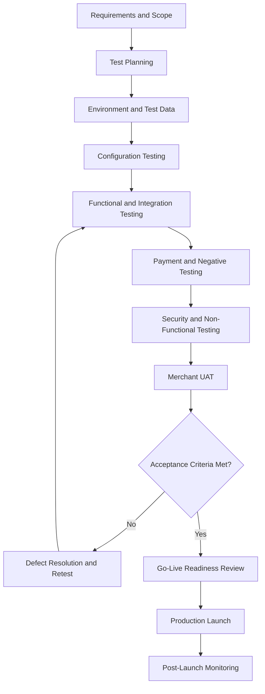

# FlexiBill Testing & Certification

> A structured playbook for validating FlexiBill configurations, APIs, billing workflows, payment collection, events, security, and merchant readiness before production launch.

**Audience:** Product, Engineering, QA, Solution Engineering, Implementation, Operations, Merchant Technical Teams  
**Scope:** Indonesia and Malaysia, subject to country and payment-method validation  
**Document status:** Internal testing and integration-readiness reference

---

## 1. Executive Overview

Testing a FlexiBill integration is not simply verifying that an API returns a successful response.

A merchant integration must demonstrate that:

- The intended billing model is configured correctly.
- Customer and subscription data are mapped correctly.
- Billing obligations are generated at the expected time and amount.
- Payment authorization is valid.
- Payment collection works through the selected integration.
- Transaction outcomes are synchronized correctly.
- Failed and uncertain transactions are handled safely.
- Reconciliation is possible.
- Security and operational controls are in place.
- The merchant understands its responsibilities.

**Core principle: A successful payment test does not prove that the complete billing and subscription lifecycle is ready for production.**

## 2. Testing Framework

The recommended testing framework has seven layers.

| Layer | Focus | Main outcome |
|---|---|---|
| 1. Configuration testing | Collection, Plan, pricing, subscription setup | Correct billing configuration |
| 2. Functional testing | Billing lifecycle and customer journeys | Correct business behavior |
| 3. Integration testing | APIs, H2H, webhooks, data mapping | Correct system communication |
| 4. Payment testing | Authorization, collection, payment outcomes | Correct payment behavior |
| 5. Negative and recovery testing | Failures, retries, duplicates, timeouts | Safe exception handling |
| 6. Non-functional and security testing | Performance, access, security, resilience | Operational readiness |
| 7. UAT and go-live validation | Merchant acceptance and operational handover | Business sign-off |

The test scope must match the actual product configuration and integration model.

## 3. Testing Lifecycle

## 4. Define the Test Scope First

Before writing test cases, document:

| Scope item | Required information |
|---|---|
| Country | Indonesia or Malaysia |
| Merchant | Merchant identity and business model |
| Product model | Billing Automation, API/H2H, Hybrid, or Merchant Hosted Scheduler |
| Billing model | One-off, recurring, usage-based, installment, or other |
| Collection setup | Collection and Plan configuration |
| Pricing | Flat fee, per unit, tiered, volume, stairstep, or open amount where supported |
| Customer interface | Pricing Table, Member Center, Billing Portal, merchant application, or API |
| Payment method | Actual method selected for the merchant |
| Authorization | Required authorization or mandate workflow |
| Payment initiation | Supported collection operation |
| Events | Webhook and inquiry mechanisms |
| Reporting | Transaction and settlement reporting |
| Merchant ownership | Systems and responsibilities retained by merchant |

Do not test against capabilities that have not been confirmed for the selected merchant, country, and integration.

## 5. Test Environment and Test Data

### Environment controls

- Use approved non-production environments.
- Separate test and production credentials.
- Use approved test payment instruments and scenarios.
- Do not use real customer credentials in test environments.
- Do not expose production secrets in test scripts.
- Keep test data identifiable as test data.
- Confirm environment-specific API endpoints and configurations.

### Recommended test data

| Data set | Example purpose |
|---|---|
| Merchant | Valid and invalid merchant configuration |
| Customer | New, existing, incomplete, and duplicate customer records |
| Subscription | Active, pending, expired, and cancelled scenarios |
| Collection | Valid, expired, and invalid configuration |
| Plan | Different pricing and billing-cycle scenarios |
| Billing | Due, overdue, paid, and cancelled obligations |
| Payment authorization | Success, failure, pending, and revoked |
| Payment transaction | Success, decline, pending, and timeout |
| Webhook | Valid, invalid, duplicated, and delayed events |
| Reconciliation | Matched, unmatched, and amount-mismatch records |

Use provider-approved test data and scenarios. Do not invent production test credentials or transaction outcomes.

## 6. Configuration Testing

Validate the merchant's billing configuration before testing payment execution.

| Test area | Validation |
|---|---|
| Collection | Correct customer grouping and configuration |
| Plan | Correct pricing and billing rules |
| Pricing model | Correct supported calculation method |
| Billing interval | Correct frequency and duration |
| Billing date | Correct date and timezone behavior |
| Subscription duration | Correct end condition or number of charges |
| Grace and overdue | Correct configured behavior |
| Expiration | Correct handling of expired billing or membership |
| Pricing Table | Correct display and purchase flow where used |
| Member Center | Correct supported membership and registration workflow |
| Billing Portal | Correct customer access and supported self-service |
| Account Billing | Correct calendar-date billing behavior where applicable |

Do not assume that every configuration option is available in every FlexiBill integration model.

## 7. Functional Testing

### Core billing lifecycle

| Test case | Expected result |
|---|---|
| Create billing relationship | Correct customer and subscription association |
| Create billing obligation | Correct amount and due date |
| Generate recurring billing | Correct billing schedule |
| Generate one-off billing | Correct single billing obligation |
| Change supported configuration | Correct future billing behavior |
| Reach subscription end | Correct end-of-term behavior |
| Billing becomes overdue | Correct overdue state or handling |
| Billing expires | Correct expiry behavior |
| Customer cancels | Correct supported cancellation behavior |
| Customer renews | Correct renewal behavior where supported |
| Customer pays manually | Correct payment-to-billing mapping |

### Merchant-specific testing

Validate any merchant-owned business rules independently, including:

- Student or policyholder records.
- Booking and reservation details.
- Service entitlement.
- Contract and account hierarchy.
- Usage calculation.
- Discounts and promotions.
- Customer eligibility.
- Refund and cancellation policy.

FlexiBill should not be assumed to own business rules that remain within the merchant's system.

## 8. API and H2H Integration Testing

For API and H2H integrations, validate:

- Authentication.
- Request structure.
- Required fields.
- Data types and formats.
- Merchant and customer references.
- Billing and subscription identifiers.
- Amount and currency.
- Successful responses.
- Error responses.
- Timeout behavior.
- Inquiry operations.
- Duplicate request handling.
- Environment configuration.

### API test checklist

| Test | Expected result |
|---|---|
| Valid request | Accepted according to API contract |
| Missing required field | Correct validation failure |
| Invalid data type | Correct validation failure |
| Invalid merchant context | Correct rejection |
| Incorrect amount | Correct rejection or validation behavior |
| Unauthorized request | Access denied |
| Timeout | Outcome handled without blind retry |
| Duplicate request | Duplicate protection behaves as designed |
| Inquiry | Correct transaction or billing status |
| Invalid reference | Correct handling of unknown reference |

Confirm actual endpoint names, schemas, authentication mechanisms, and status values using official DOKU documentation.

## 9. Payment Authorization and Collection Testing

Test the complete payment lifecycle, not just the first transaction.

| Scenario | Expected result |
|---|---|
| New customer authorization | Required authorization flow completes |
| Authorization success | Correct result and reference stored |
| Authorization failure | No unauthorized recurring collection |
| Authorization pending | No premature activation |
| Valid recurring collection | Correct payment initiation |
| Payment success | Billing and payment records synchronized |
| Payment decline | Correct failure classification |
| Insufficient funds | Approved recovery process triggered |
| Credential expiry | Approved update or reauthorization |
| Authorization revoked | Subsequent recurring collection stopped |
| Customer changes method | Correct new payment reference association |
| Customer-initiated payment | Correct payment and billing mapping |

Test WT and AB only after confirming their official technical contracts, scope, and payment-method eligibility.

## 10. Webhook and Event Testing

| Scenario | Expected result |
|---|---|
| Valid webhook | Authentic event accepted |
| Invalid signature or verification | Event rejected or safely quarantined |
| Duplicate webhook | No duplicate business action |
| Delayed webhook | Event processed safely |
| Out-of-order webhook | No invalid state regression |
| Missing webhook | Inquiry or reconciliation detects discrepancy |
| Processing failure | Event retained for controlled recovery |
| Event replay | Processing remains safe and traceable |
| Unknown transaction reference | Exception raised for investigation |

Verify the documented DOKU event contract and authenticity mechanism. Do not assume exactly-once or chronological delivery.

## 11. Negative and Recovery Testing

Negative testing verifies that the system behaves safely when things go wrong.

| Scenario | Required behavior |
|---|---|
| Invalid billing configuration | Billing generation prevented or rejected |
| Missing customer data | Controlled validation failure |
| Invalid pricing data | Incorrect billing not processed |
| Payment timeout | Inquiry before retry |
| Provider unavailable | Controlled deferral or recovery |
| Duplicate collection request | No unintended duplicate payment |
| Payment result delayed | Billing status not prematurely changed |
| Revoked authorization | Collection stopped |
| Invalid webhook | No unauthorized state update |
| Reconciliation mismatch | Exception created and assigned |
| Refund mismatch | Original and corrective records remain traceable |
| Merchant migration | No assumed token portability or duplicate billing |

## 12. Concurrency and Idempotency Testing

Recurring collection systems must handle simultaneous events safely.

Test:
- Two collection requests for the same billing obligation.
- Duplicate API submission.
- Simultaneous webhook processing.
- Retry while original payment remains pending.
- Multiple workers attempting to process one due billing.
- Customer payment while an automatic collection is in progress.
- Repeated event delivery.

Expected outcomes:
- No unintended duplicate charge.
- No lost payment result.
- No invalid billing state transition.
- Original transaction references remain traceable.
- Recovery is deterministic and auditable.

Use provider-supported idempotency where available and merchant-side duplicate controls where required.

## 13. Performance and Resilience Testing

Validate system behavior under expected and exceptional loads.

| Area | Test focus |
|---|---|
| API throughput | Expected transaction and billing request volume |
| Batch processing | Bulk billing and collection workloads |
| Scheduling | Large numbers of billing obligations becoming due |
| Webhook processing | Event throughput and processing backlog |
| Recovery | Reprocessing after temporary outages |
| Availability | Behavior during service interruption |
| Latency | End-to-end response and processing times |
| Data volume | Reporting and reconciliation at expected scale |

Performance thresholds must be agreed with the relevant engineering and provider teams. Do not invent DOKU service-level commitments.

## 14. Security Testing

Security testing should include:

- Authentication and authorization.
- Role and permission enforcement.
- Secret and credential protection.
- Sensitive data masking.
- API input validation.
- Webhook authenticity verification.
- Access to merchant and customer data.
- Environment separation.
- Logging and audit controls.
- Dependency and vulnerability review where required.

Follow DOKU security review procedures and the Security & Data Protection playbook.

## 15. Reconciliation and Reporting Testing

| Scenario | Expected result |
|---|---|
| Successful payment | Correct billing-to-payment match |
| Multiple attempts | All attempts traceable to original billing |
| Payment pending | Not prematurely reconciled as success or failure |
| Payment without billing match | Exception created |
| Billing without payment | Unpaid obligation identified |
| Settlement pending | Payment and settlement statuses remain distinct |
| Fee mismatch | Financial exception identified |
| Refund | Original transaction and refund linked |
| Duplicate payment | Duplicate exception identified |
| Missing report data | Reporting completeness issue detected |

Test both operational transaction reporting and financial settlement reconciliation.

## 16. Merchant UAT

User Acceptance Testing confirms that the implemented workflow meets the merchant's business needs.

### UAT participants

| Participant | Responsibility |
|---|---|
| Merchant business owner | Confirms business requirements |
| Merchant technical team | Confirms integration behavior |
| Merchant operations | Confirms day-to-day processes |
| Finance team | Confirms payment and reconciliation |
| DOKU Solution Engineering | Supports solution validation |
| DOKU Product | Confirms intended product behavior |
| DOKU Engineering / QA | Supports technical defect resolution |

### UAT acceptance criteria

- Correct customer registration.
- Correct subscription setup.
- Correct billing generation.
- Correct amount and due date.
- Correct payment authorization.
- Successful payment collection.
- Correct failure handling.
- Correct customer communication.
- Correct payment-to-billing mapping.
- Reconciliation and reporting accepted.
- Operational support process agreed.

The merchant should document its UAT approval.

## 17. Defect Management

Each defect should include:

| Field | Description |
|---|---|
| Defect ID | Unique internal reference |
| Merchant | Affected merchant |
| Country | Indonesia / Malaysia |
| Environment | Test / production |
| Component | Billing, API, payment, webhook, reporting |
| Severity | Critical / High / Medium / Low |
| Reproduction steps | How to reproduce |
| Expected result | Intended behavior |
| Actual result | Observed behavior |
| Evidence | Sanitized logs and references |
| Owner | Responsible team |
| Resolution | Fix or agreed workaround |
| Retest result | Pass / Fail |

### Severity guidance

- **Critical:** Security incident, duplicate collection risk, major production-blocking failure.
- **High:** Core billing or payment workflow cannot operate.
- **Medium:** Significant feature or exception handling issue with a workaround.
- **Low:** Minor display, documentation, or non-blocking issue.

Use the formal DOKU defect severity model where one exists.

## 18. Integration Readiness and Go-Live Decision

Do not treat internal integration readiness as a formal external certification unless DOKU has explicitly defined such a process.

Recommended readiness stages:

| Stage | Meaning |
|---|---|
| Requirements validated | Scope and merchant requirements agreed |
| Configuration validated | Billing setup reviewed |
| Integration tested | APIs and events tested |
| Payment tested | Authorization and collection validated |
| Negative paths tested | Recovery and exception handling validated |
| UAT approved | Merchant accepts business workflow |
| Operational readiness | Monitoring, support, and reconciliation ready |
| Go-live approved | Authorized stakeholders approve production launch |

### Go-live decision

A launch should not proceed when there is an unresolved critical security issue, uncontrolled duplicate-payment risk, unverified payment outcomes, or an untested critical billing workflow.

Any exception must have a documented owner, impact assessment, and authorized approval.

## 19. Indonesia and Malaysia Validation

Test country-specific behavior independently.

| Test area | Validation |
|---|---|
| Merchant eligibility | Correct account and product setup |
| Payment methods | Actual supported methods |
| Authorization | Country and method-specific customer flow |
| Collection | Correct recurring payment operation |
| API behavior | Correct country-specific configuration |
| Webhooks | Correct event and status behavior |
| Currency | Correct amount and currency handling |
| Settlement | Correct reporting and settlement behavior |
| Security and privacy | Country-specific review |
| Customer experience | Language and local business requirements |

Passing an Indonesian test does not automatically establish Malaysian readiness, or vice versa.

## 20. Known Gaps and Strategic Opportunities

Potential product and platform improvements:

- Standard merchant integration test suite.
- Automated configuration validation.
- Reusable test scenarios by industry.
- Payment lifecycle simulation.
- Webhook replay and diagnostic tooling.
- Automated reconciliation testing.
- Merchant UAT templates.
- Country-specific readiness matrices.
- Integration health dashboards.
- Release regression automation.

These are strategic opportunities, not claims of current native FlexiBill availability.

## 21. Go-Live Checklist

- [ ] Requirements and integration model approved.
- [ ] Test environment configured.
- [ ] Test credentials secured.
- [ ] Billing configuration tested.
- [ ] Customer and subscription workflows tested.
- [ ] API and H2H integration tested.
- [ ] Authorization and payment collection tested.
- [ ] Webhook and event processing tested.
- [ ] Negative and recovery scenarios tested.
- [ ] Idempotency and concurrency tested.
- [ ] Security review completed.
- [ ] Performance and resilience assessed.
- [ ] Reconciliation and reporting tested.
- [ ] Merchant UAT approved.
- [ ] Critical defects resolved.
- [ ] Monitoring and incident ownership confirmed.
- [ ] Country-specific validation completed.
- [ ] Production go-live approval obtained.

## 22. Related Playbooks

- [Integration Architecture](01-integration-architecture.md)
- [API & H2H Integration](02-api-and-h2h-integration.md)
- [Webhook & Event Management](03-webhook-and-event-management.md)
- [Billing Orchestration](04-billing-orchestration.md)
- [Payment Authorization & Collection](05-payment-authorization-and-collection.md)
- [Error Handling & Recovery](06-error-handling-and-recovery.md)
- [Reconciliation & Reporting](07-reconciliation-and-reporting.md)
- [Security & Data Protection](08-security-and-data-protection.md)
- [Technical Solution Patterns](10-technical-solution-patterns.md)

---

**FlexiBill Testing & Certification**

*Test the complete lifecycle. Prove the exception paths. Launch with evidence.*
